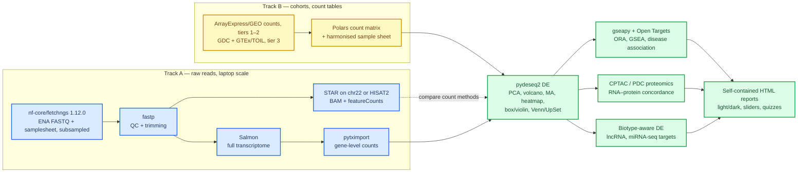

# Cancer Transcriptomics Teaching Suite — plan

Status: **draft v3.2 (2026-09-26) — Phase 1 closed; M1 restructured around nf-core/fetchngs 1.12.0 (find → fetch → make usable) with a dataset-independent Phase 1b; D1, D2, D4, D11–D20 resolved; remaining Phase 0 items: D5 dataset verification and version pinning.**
Outputs of this plan: a Python package + CLI, one Jupyter notebook per module, and one self-contained interactive HTML report per module, linked from a hub page.

---

## 🎯 Goal and learning outcomes

Students analyse public human cancer RNA-seq (ENA / GEO / TCGA) end to end on a laptop, connect it to public proteomics, and leave able to:

1. Choose the right data tier and repository for a question (raw reads vs processed counts; open vs controlled access), trace a paper's accession through GEO/SRA/ENA, and fetch reads reproducibly with nf-core/fetchngs.
2. Judge whether reads are usable from QC metrics, and know what trimming/filtering parameters do.
3. Explain what an aligner, a pseudo-aligner and a read counter each produce, and why counts differ between them.
4. Set up a differential-expression (DE) design correctly (pairing, covariates, filtering, multiple testing, shrinkage) and read the diagnostics.
5. Translate a DE gene list into biology (pathways, cellular roles, disease associations) without over-interpreting.
6. Read every figure type in the syllabus (box, violin, heatmap, volcano, MA, PCA, Venn/UpSet, enrichment) with its statistical annotation.
7. Test whether an RNA change is carried through to protein, and name the reasons it may not be (translational control, protein stability, timing of synthesis, complex stoichiometry, non-coding function).
8. State what standard RNA-seq can and cannot say about lncRNAs and miRNAs, and choose the right library type, annotation and filters for each.

Pedagogical device used throughout: **"turn the knob"** — every module exposes 2–4 parameters as interactive controls or precomputed alternatives, so students see how a choice changes the result.

---

## 🏗️ Architecture: two tracks, one downstream

A full human alignment does not fit the RAM/speed constraint (STAR full-genome index needs ~32 GB). The design therefore separates the *read-level concepts* (taught on a laptop-sized subset of raw reads) from the *cohort-level statistics* (taught on count tables). Cohorts follow the agreed ladder: innate immune cells first, other immune cells second, large solid-tumour cohorts with large healthy groups third. For the immune-cell tiers one public dataset serves both tracks (raw FASTQs on ENA for Track A, the full cohort for Track B), so students follow one biology from reads to pathways. TCGA enters at tier 3 as processed counts only, since TCGA FASTQ/BAM are dbGaP-controlled.



| Concern | Track A (raw reads) | Track B (count tables) |
| --- | --- | --- |
| Teaches | Modules 1–4 (fetch, QC, trim/align, quantify) | Modules 1, 5–8 (fetch, DE, function, RNA→protein, non-coding RNA) at realistic n |
| Data size | ~6–8 samples × 1M read pairs (~1 GB total) | tier 1 ≈ 200 samples (tens of MB); tier 3 ≈ 150–1000 samples (< 1 GB) |
| Peak RAM target | < 6 GB | < 4 GB |
| Wall time target | < 15 min on 4 cores | < 10 min on 4 cores |
| Why | Real tools, real parameters, visible effects | Real biology, real statistics, nested and paired designs |

Bridges between tracks: for tiers 1–2 the dataset itself — Track A quantifies a subset of the very samples whose full cohort Track B analyses, and the two count vectors are compared directly; for tier 3, STAR `--quantMode GeneCounts` produces the same four-column table (unstranded / stranded-first / stranded-second) that GDC exposes in its STAR-Counts files, so students see where TCGA numbers come from.

---

## 📦 Datasets

Cohort ladder agreed at check-in: innate immune cells → other immune cells → large solid-tumour cohorts with large healthy groups. Criteria for every candidate: human, bulk RNA-seq, cancer vs healthy groups with n ≥ 10 per group, raw FASTQs open on ENA (needed for Track A), rich sample metadata, permissive licence.

| Tier | Candidate | Design | Why | Verify before use |
| --- | --- | --- | --- | --- |
| 1 — innate immune cells (primary) | ArrayExpress E-MTAB-11190 (released 2022-11): bulk RNA-seq of normal-density neutrophils, low-density neutrophils and monocytes from blood; healthy controls n = 19, G-CSF-treated donors n = 17, HSCT recipients n = 8, PDAC n = 15, IPMN n = 14; 210 samples from 73 individuals; source publication Montaldo et al. 2022 Nat Immunol 23:1470–1483, doi:10.1038/s41590-022-01311-1, PubMed 36138183 (corrected 2026-09-27: the earlier "Caronni et al. 2023 Nature" was asserted from memory; Caronni is a co-author) | Cell type × condition, nested within donor | Neutrophils and monocytes in cancer vs healthy at usable n; stress-induced myelopoiesis story (G-CSF, LDN vs NDN); one dataset serves both tracks | ENA project accession and FASTQ availability, library layout and read length, SDRF fields (cell type, condition, donor, batch), processed counts provided or not, source publication and its positive-control genes, licence |
| 1 — alternative | Cassetta et al. 2019 Cancer Cell: circulating monocytes from breast / endometrial cancer patients vs healthy donors; TAMs vs tissue-resident macrophages | Cell type × cancer status | Systemic and local myeloid reprogramming; complements the neutrophil dataset | GEO accession, FASTQs on ENA, group sizes |
| 2 — other immune cells | TCGA-LAML (myeloid leukaemia, ~150 cases) or TCGA-DLBC (B-cell lymphoma, ~48 cases) plus a healthy sorted-cell comparator from GEO (bone-marrow CD34+ / B cells) | Cancer vs healthy across studies | Teaches the cross-study batch problem explicitly: same lineage, different labs | Comparator accession, protocol match (poly-A vs total RNA), current TCGA case counts |
| 3 — solid tumours, large cohorts | TCGA tumour vs solid-tissue-normal (KIRC ~70 pairs, BRCA ~110 pairs, LUAD ~55 pairs) and TCGA vs GTEx through the UCSC Xena TOIL recompute (uniformly processed, hundreds of healthy samples per tissue) | Paired (TCGA) and unpaired large-n (TOIL) | Large groups; VHL→HIF→hypoxia story in KIRC; harmonisation and batch lessons in the TOIL comparison | Pair counts in current GDC release; current TOIL file names and gene model |
| Proteomics, tier 3 | CPTAC-3 ccRCC (Clark et al. 2019 Cell): tumour and normal-adjacent tissue with matched RNA-seq (open at GDC) and TMT proteomics (open at the Proteomic Data Commons); CPTAC LUAD / PDAC as alternatives | Same samples measured at RNA and protein level | Direct RNA–protein concordance on the tier-3 cancer; PDAC option echoes tier 1 | Case counts with both layers; PDC / `cptac` access route; TMT batch layout |
| Proteomics, tier 1 | Rieckmann et al. 2017 Nat Immunol immune-cell proteome (PRIDE; healthy donors; protein copy numbers per cell type incl. neutrophils and monocytes) | Cross-dataset: RNA from tier 1 vs protein per cell type | Neutrophil vs monocyte RNA–protein discordance (granule proteins are transcribed early in granulopoiesis, so mature neutrophils carry high protein with low mRNA) | PRIDE accession; processed copy-number table availability; cell-type labels matching tier 1 |
| miRNA-seq, tier 3 | TCGA-KIRC miRNA-seq (mature-miRNA and isoform quantification, open at GDC) for the same cases as mRNA-seq | Matched mRNA + miRNA per sample | miRNA–target anticorrelation and its protein footprint in CPTAC | Number of normals with miRNA-seq; GDC file types and normalisation |
| ncRNA resources | GENCODE biotypes; TargetScan predicted targets (context++ scores); miRTarBase validated targets; LncBook / Lnc2Cancer for disease-linked lncRNAs; GENCODE Ribo-seq ORF annotation to flag "non-coding" genes with translation evidence | — | Annotation is a status, not a proof | Download terms (miRTarBase academic licence); current versions |
| Track A subset | 3–4 donors × 2–3 cell types from tier 1, subsampled (`seqtk sample -s42`, 1M pairs/sample) on Kebnekaise, hosted on Zenodo with DOI + md5, as one nf-core/fetchngs outdir from a fetchngs run whose input is exactly the subset runs (fetchngs names and samplesheet; `fastq/md5/` rewritten for the subsampled bytes) | — | Students never download tens of GB; same biology as Track B | Zenodo quota, redistribution terms |
| References | GENCODE primary assembly + GTF (current release), chr22 slice for STAR, transcript FASTA for Salmon, tx2gene from GTF | — | Versions pinned in every `_README.md` | Current GENCODE release; GENCODE version behind current GDC STAR-Counts |
| Gene sets | MSigDB Hallmark, GO BP, Reactome (GMTs cached by `ctx setup`); Enrichr disease libraries (DisGeNET, Jensen DISEASES, GWAS Catalog) as GMTs; Open Targets GraphQL for per-gene disease scores; NCG cancer-gene list; immune sets (MSigDB C7 ImmuneSigDB, neutrophil/monocyte state signatures from the source paper) | — | Offline-capable, permissive; immune sets make tier-1 results interpretable | Current MSigDB version string; Enrichr library names |

---

## 🧩 Module specification

Each module = one CLI subcommand (`ctx <module>`), one notebook (`notebooks/0N_<module>.ipynb`, student + solution variants), one HTML report. Every report follows the same skeleton: **big question → concept in plain English → parameter cards → annotated results → what it means in practice → think-about-it prompts / self-check quiz → exact reproduction command with runtime and peak RAM**.

### M0 — Setup

- `ctx setup`: creates `resources/` (references, indices, GMTs, teaching subset) with checksums; prints environment report (versions, CPU, RAM).
- Environment: pixi (conda-forge + bioconda) → Docker (multi-stage, from `codebase_template`) → Apptainer SIF.
- Knob: none. Output: `resources/manifest.json` + README.

### M1 — Gather public data

Three lessons, because finding data, fetching it and making it usable are different skills. Raw reads enter only through nf-core/fetchngs 1.12.0; the facts below were read from its 1.12.0 code (D-006).

#### M1a — Find the accession

- Start from a paper's data-availability statement. Teaches repositories and their data tiers (raw vs processed; open vs controlled), and the accession alphabet and hierarchy (study → sample → experiment → run): GEO GSE/GSM; SRA SRP/SRS/SRX/SRR with BioProject PRJNA and BioSample SAMN; ENA ERP/ERS/ERX/ERR with PRJEB and SAMEA; DDBJ DRP/DRX/DRR with PRJDB; ArrayExpress E-MTAB, mirrored to ENA as an ERP/PRJEB study.
- Where reads live: GEO and ArrayExpress hold metadata and processed files; the reads sit in SRA, ENA and DDBJ, which mirror each other. ENA serves ready-made FASTQ over FTP/Aspera; SRA serves `.sra` objects that need sra-tools.
- Three routes, all shown with the real tier-1 study: GEO page → SRA Run Selector → Accession List (`SRR_Acc_List.txt`); ENA Browser text search → read-files report (TSV); BioStudies/ArrayExpress page → linked ENA study. Scripted, in the notebook and not in ctx: `pysradb` (`gse-to-srp`, `metadata --detailed`), the ENA Portal API `filereport`, and a metadata-only fetchngs run (M1b).
- Before downloading, read `library_layout`, `library_strategy`, `library_selection` (PolyA vs RANDOM/other — the M8 library-type lesson starts here), `instrument_model`, `read_count` and `fastq_bytes`, and budget the transfer.
- Knob: ID level submitted (a study ID pulls every run; a run ID pulls every run of its experiment, because fetchngs resolves runs to experiments), ENA fields requested (`--ena_metadata_fields`).
- Figures: study map (paper → GSE → SRP → SRX → SRR → FASTQ); per-run read-count and `fastq_bytes` bars; library-type composition.

#### M1b — Fetch with nf-core/fetchngs 1.12.0

- Input: one ID per line, no header, LF line endings, no space anywhere in the path. Accepted: SRR/SRX/SRS/SRP/SRA/PRJNA/SAMN, ERR/ERX/ERS/ERP/ERA/PRJEB/SAMEA, DRR/DRX/DRS/DRP/DRA/PRJDB/SAMD, GSM/GSE. `E-MTAB-*` is rejected: give an ArrayExpress study as its ERP/PRJEB accession. One line that fails the pattern aborts the whole run.
- Course command, one fresh outdir per run: `nextflow run nf-core/fetchngs -r 1.12.0 -profile <docker | docker,arm | singularity> --input data/raw/<slug>/ids.csv --outdir data/raw/<slug> --nf_core_pipeline rnaseq`. `docker,arm` on Apple silicon runs the amd64-only images under emulation; on Kebnekaise use the lab's `SHARED_run_fetchngs.sbatch` (`-profile singularity`). Nextflow 26 needs `NXF_SYNTAX_PARSER=v1` for this release. `--nf_core_pipeline rnaseq` adds one column, `strandedness` = `auto`, after `fastq_2`. A run with no ENA FASTQ link falls back to sra-tools on its own; `--download_method sratools` is for runs with more than two files (FTP keeps the last two); `aspera` is faster but not for runs with more than two files.
- Two class runs, each into its own outdir (a re-run into an existing outdir rebuilds the samplesheet from the new input only): (1) `--skip_fastq_download` on the full study into `data/raw/<dataset>_meta`, metadata and samplesheet only; (2) a real download of the 2–4 smallest runs chosen from `fastq_bytes` into `data/raw/<dataset>_dl`, each file md5-checked by fetchngs as it lands (FTP and Aspera only). `ctx gather` reads one outdir per call. The rest of the Track A subset comes from Zenodo, itself one fetchngs outdir.
- Teaches: `-resume`, `-profile`, `-work-dir` (it holds a second copy of every FASTQ); what `pipeline_info/` records (`params_<timestamp>.json`, `nf_core_fetchngs_software_mqc_versions.yml`, the execution trace) and why it goes into the README; why the samplesheet must be curated (fetchngs itself warns that public databases do not reliably hold strandedness).
- Output layout the suite consumes: `fastq/<EXP>_<RUN>.fastq.gz` (single-end) or `fastq/<EXP>_<RUN>_1.fastq.gz` and `_2.fastq.gz`; `fastq/md5/<fastq name>.md5` (FTP and Aspera downloads only); `metadata/<INPUT_ID>.runinfo_ftp.tsv`, one per input line (no `*.runinfo.tsv` in 1.12.0); `samplesheet/samplesheet.csv` (`sample` = experiment accession, `fastq_1`, `fastq_2`, `strandedness`, then the 31 default ENA fields; one row per run; every field quoted; paths written as `<outdir as given>/fastq/<name>`); `samplesheet/id_mappings.csv`; `samplesheet/multiqc_config.yml`; `pipeline_info/` (timestamped names).

#### M1c — Make it usable: `ctx gather`

- Ingests one fetchngs outdir (tiers 1–2) or a GDC/Xena download (tier 3, Phase 4) and writes the harmonised sample sheet every later module reads; nothing downstream touches `samplesheet.csv` directly, and gather never writes into the fetchngs outdir.
- Reads `samplesheet/samplesheet.csv` with Polars as text; refuses any fetchngs release but the pinned one; resolves every FASTQ by file name inside `<outdir>/fastq/`, never by the path written in the sheet; verifies each file against `fastq/md5/` and reports runs with no md5 file (the sra-tools path) instead of failing them; marks files as not downloaded in a metadata-only outdir; checks that `id_mappings.csv` agrees with the sheet; checks that every input ID has a `metadata/` file and every run listed there has a samplesheet row.
- Curation (Phase 2): parses `sample_title` (or another named field) into `donor`, `cell_type`, `condition`, `replicate`, `batch` with a per-dataset regex, or joins the tier-1 SDRF, from `conf/datasets/<dataset>.toml`; unparsed titles go to a validation table and the command fails. Lesson: public metadata is free text and must be curated.
- Multi-run samples (several rows sharing one `sample`) keep one row per run with `run_index` and `n_runs`. Lesson: technical vs biological replicates. Runs are combined where FASTQs are consumed (M2–M4), never by rewriting the fetchngs outdir.
- `strandedness` stays `auto` and is filled by M4 from Salmon's `lib_format_counts.json`; `library_selection` and `library_strategy` are carried to M8.
- Records in the `_README.md` the fetchngs version string, the Nextflow version, and the SHA-256 of every `pipeline_info/` file read.
- Annotations beyond the reads: the tier-1 SDRF and processed files from BioStudies/ArrayExpress (Phase 2, after D5); GEO comparator metadata and counts via `GEOparse` (tier 2). Tier 3: GDC REST API (`files`, `cases`, `data`) via `requests` and UCSC Xena TOIL downloads produce the same sheet columns (sample, case, sample_type, condition, batch), so downstream code is identical.
- Teaches (tiers 2–3): sample-type codes (01 tumour / 11 normal), one aliquot per sample, pairing by donor or case ID, metadata hygiene, cross-study batch as a design constraint.
- Knob: curation file; metadata-only vs downloaded outdir; cell-type and condition filters (tier 1), cancer project and sample type (tier 3), minimum group size.
- Figures: cohort composition bars; metadata completeness heatmap; unparsed-title table; library-size bars (`read_count` for fetchngs runs, `N_*` summary rows for GDC STAR-Counts).
- Stats: none inferential; descriptive tables.
- Output: the fetchngs outdir under `data/raw/<slug>/`, untouched; `outputs/01_gather/YYYY-MM-DD_gather_<slug>_samplesheet_v<N>` (Parquet + CSV) + `_README.md`; count matrices assembled lazily (`scan_csv`, comment rows dropped, count column selected, Int32 downcast, `estimated_size()` recorded).

### M2 — Read QC

- Tools: `fastp` (JSON parsed into Plotly), `seqkit stats`, MultiQC for the classic aggregate.
- Teaches: per-position quality, GC content, adapter content, duplication, insert size, Q30 rate; what "unusable" looks like (planted bad sample: adapter-heavy or low-Q30 subset); why neutrophil libraries are special (low RNA content, granule-protein and ribosomal signal, degradation), read from the real tier-1 data.
- Knob: quality threshold `-q`, unqualified-base % `-u`, min length `-l`, `--cut_tail` window/mean.
- Figures: per-position quality curves with threshold line; GC/duplication distributions; before/after read-count Sankey (Mermaid in notebook, Plotly in report).
- Stats: descriptive; flag rules explained (why Q30 < 80 % is a warning, not a verdict).

### M3 — Trim, filter, align, count

- Tools: `fastp` (trim), `STAR` on chr22 index (`--genomeSAindexNbases 11`, `--quantMode GeneCounts`, `--outSAMtype BAM SortedByCoordinate`), optional `HISAT2` full-genome low-RAM path, `samtools flagstat/idxstats`, `featureCounts`.
- Teaches: splice-aware alignment, multimappers (`--outFilterMultimapNmax`), strandedness (`-s 0/1/2`; inferred from Salmon `lib_format_counts.json`), fragment vs read counting (`-p --countReadPairs`), overlap handling (`-O`, `--fraction`), incomplete reference as an error source (chr22-only vs full → mapping-rate drop).
- Knob: strandedness setting, multimapper limit, chr22 vs full reference.
- Figures: mapping-rate bars per setting; strandedness column comparison; STAR-GeneCounts vs featureCounts scatter with concordance stats.
- Stats: Spearman/Pearson concordance with CI; Bland–Altman style bias plot.

### M4 — Transcript/gene quantification

- Tools: `Salmon` (`-l A`, `--gcBias`, `--seqBias`, decoy-aware index if hosted, else no-decoy with the trade-off explained), `pytximport` (`counts_from_abundance` options).
- Teaches: TPM vs counts vs CPM; effective length; why DE wants counts; why pydeseq2 receives `length_scaled_tpm` counts (no per-sample offset matrix support — stated honestly); mapping rate vs assignment rate.
- Knob: `counts_from_abundance`, bias correction on/off.
- Figures: library-size and count-distribution box/violin; gene-detection curves; sample–sample correlation heatmap with dendrogram; Salmon vs STAR vs featureCounts Venn of detected genes.
- Stats: Spearman correlation matrix; hierarchical clustering (average linkage, optimal leaf ordering).

### M5 — Differential expression

- Tools: `pydeseq2` (design formulas `~ donor + condition` for paired tissue, `~ cell_type + condition` or `~ cell_type * condition` for tier 1; `DeseqStats` with BH, independent filtering, Cook's; `lfc_shrink`; `lfc_null` threshold test; `vst()` for PCA/heatmap), `scipy.stats`, `scikit-bio` PERMANOVA.
- Teaches: pre-filtering (edgeR-style "≥10 counts in ≥ smallest group"), size factors (median-of-ratios), dispersion trend/shrinkage, Wald test, FDR in plain English, NA `padj` meaning, effect size vs significance, shrinkage, paired vs unpaired design, cell type as the dominant axis with disease nested inside it (contrasts and interaction terms), p-value histogram as a health check, batch inspection (sequencing batch in tier 1; TCGA barcode TSS/plate in tier 3).
- Knob: design (paired / unpaired; with / without cell type), contrast selector, `padj` and |LFC| sliders, shrunken vs raw LFC toggle, `lfc_null` threshold, min-count filter (precomputed grid).
- Figures: PCA (VST, top-500 variable genes; PERMANOVA pseudo-F and p annotated; colour = condition, symbol = cell type or batch); dispersion plot; p-value histogram; volcano (sliders, top-gene labels, up/down counts); MA (raw vs shrunk); heatmap of top 50 (z-scored VST, clustered, group colour bar); box + violin of top genes with paired lines, Wilcoxon signed-rank (paired) or Mann–Whitney, BH across plotted genes, rank-biserial effect size, DESeq2 `padj` shown alongside with a note on why they differ; Venn/UpSet: paired vs unpaired, shrunk vs raw thresholds, neutrophil vs monocyte cancer responses (tier 1), KIRC vs BRCA vs LUAD (tier 3).
- Output: results table (Parquet + CSV) with data dictionary; `_README.md` records design, versions, filters.

### M6 — Function and disease association

- Tools: `gseapy` (`enrich` with explicit background = tested genes; `prerank` on Wald stat, 1000 permutations, seed 42, `min_size 15`, `max_size 500`), ImmuneSigDB and source-paper signatures as extra GMTs, optional `decoupler` PROGENy pathway activity, Open Targets GraphQL, NCG list; `ctx.function.lite` pure-NumPy ORA and prerank-GSEA (validated against gseapy in tests) for the browser.
- Teaches: ORA vs GSEA; the background trap (same list, three backgrounds → inflated results demo); ranking metric choice; term redundancy; "association ≠ causation" for disease sets; how tier-1 results map onto emergency granulopoiesis and immunosuppressive myeloid states, and how KIRC hypoxia/glycolysis output maps onto VHL biology and therapy.
- Knob: background choice, ranking metric, DE thresholds feeding ORA (live, client-side hypergeometric on embedded Hallmark + Reactome).
- Figures: dot/bar plots (−log10 FDR, gene ratio, count); GSEA running-score plots; enrichment-map network (Jaccard-linked terms); disease-association bars (Open Targets score, DisGeNET ORA); gene-to-term heatmap.
- Stats: hypergeometric/Fisher with BH; GSEA permutation FDR; term-similarity Jaccard.

### M7 — Is the transcript a template? RNA versus protein

- Tools: `cptac` package or PDC GraphQL API via `requests` for CPTAC protein tables; GDC RNA-seq for the same cases; `scipy.stats` (Spearman, Welch t, Kolmogorov–Smirnov); `statsmodels` (BH); optional `inmoose` limma port for moderated t-tests (verify).
- Teaches: what MS proteomics measures (peptides → protein groups; TMT ratios; missing values are not zeros; ratio compression); joining layers by case ID and gene symbol / UniProt mapping (isoforms, many-to-one); three questions — does protein track RNA across samples (per-gene Spearman ρ), does the tumour-vs-normal change carry to protein (log2FC concordance), which genes change at RNA only or protein only; reasons for discordance: translational control, protein half-life, complex stoichiometry (subunits buffered), secretion, timing of synthesis (neutrophil granule proteins), and genuinely non-coding function; Ribo-seq as the missing middle layer (translation efficiency; microproteins/smORFs) — concept only (D12).
- Knob: correlation method, minimum samples with protein quantified, log2FC concordance threshold, gene class (complex subunits / enzymes / secreted), predicted vs validated protein evidence.
- Figures: RNA log2FC vs protein log2FC scatter with quadrant counts and Spearman ρ (bootstrap 95 % CI); violin of per-gene ρ by gene class; concordance MA (mean abundance vs RNA−protein LFC difference); Venn/UpSet of DE at RNA vs protein; heatmap of paired RNA/protein z-scores for top genes; tier 1: neutrophil-vs-monocyte RNA fold change vs protein copy-number fold change with granule proteins highlighted.
- Stats: per-gene Spearman with BH; across-gene concordance ρ; class comparisons Kruskal–Wallis + Dunn with BH and effect sizes; protein DE by Welch t-test on log2 ratios (moderated t if available) with BH; missingness reported per protein and per sample.
- Output: merged RNA–protein table (Parquet + CSV) with data dictionary; per-gene class labels with source.

### M8 — Beyond mRNA: lncRNA and miRNA nuances

- Tools: GENCODE GTF biotypes via `pyranges` / Polars; GDC miRNA-seq quantification (reads per million miRNA-mapped; isoform tables); TargetScan / miRTarBase tables; `gseapy` for target-set enrichment; `pydeseq2` for biotype-stratified DE.
- Teaches: library type decides what is visible — poly-A selection vs rRNA depletion (non-polyadenylated lncRNAs, histone mRNAs, circRNAs) and why mature miRNAs are invisible in standard RNA-seq (size selection; small-RNA-seq with adapter trimming of inserts shorter than the read — explained, not run: D13); strandedness is needed to separate antisense lncRNAs from overlapping mRNAs (TCGA mRNA-seq is unstranded — stated as a limit); lncRNA pitfalls: low counts, length bias in TPM, multi-mapping, and how the min-count filter and independent filtering remove them; no GO terms for lncRNAs — guilt-by-association through correlated mRNAs and cis neighbours, with caveats; miRNA units, isomiRs, family-level multimapping; targets — predicted vs validated, anticorrelation across matched samples, target enrichment among downregulated mRNAs, and why repression is often clearer at protein level (M7); the ceRNA hypothesis presented as contested; "non-coding" is an annotation status — Ribo-seq ORF catalogues show translated smORFs inside annotated lncRNAs.
- Knob: biotype selection, min-count filter per biotype, target source (predicted / validated / both) and context-score threshold, library-type filter where both types exist.
- Figures: biotype composition stacked bars per sample and library type; count distributions per biotype (violin); volcano coloured by biotype; lncRNA–neighbour co-expression scatter; miRNA volcano; miRNA–target anticorrelation scatter; cumulative distribution of target vs non-target mRNA log2FC with KS statistic; miRNA→mRNA→protein tri-layer plot for selected miRNAs.
- Stats: biotype-stratified DE with BH; Spearman anticorrelation with BH; KS and Mann–Whitney for target shifts with median-shift effect size; Fisher test for target enrichment among DE genes with matched background.
- Output: biotype-annotated DE results; miRNA results; target tables with evidence source.

### Hub

- `reports/index.html`: module cards, glossary, "start here" path, teacher notes link; offline; no external requests except optional gene links (GeneCards/NCBI/Open Targets) opened on click.

---

## 📊 Figure and statistics conventions

- Palette: Okabe–Ito; font Helvetica 14 pt base; `sns.set_context("paper")`, `sns.despine()`, `plt.tight_layout()`; panel letters bold lowercase (Nature style); exact p-values, n per group, test name and effect size in-figure.
- Every figure in four variants: PDF light + dark (Seaborn, vector) and HTML with theme toggle (Plotly, `plotly_white` base + custom dark template; hover shows all relevant variables).
- Single implementation per figure type in `ctx.viz` with `static()` and `interactive()` methods sharing one data contract, so the two renderings cannot drift.
- Statistical annotation helper `ctx.viz.annotate` writes the same caption block to both renderers.

| Figure | Test / annotation |
| --- | --- |
| Box / violin | Wilcoxon signed-rank (paired) or Mann–Whitney U; BH across plotted genes; rank-biserial r; n |
| PCA | % variance per PC; PERMANOVA (Euclidean, 999 perms) pseudo-F, p |
| Volcano / MA | Wald `padj` (BH); thresholds shown; up/down counts |
| Heatmap | Linkage method, distance metric, z-score definition in caption |
| Venn / UpSet | Set sizes and intersections; Fisher test for overlap enrichment where two sets are compared |
| Enrichment | Test (hypergeometric / permutation), background size, FDR |
| Concordance scatter | Spearman ρ with 95 % CI (bootstrap) |
| RNA–protein scatter | Spearman ρ with 95 % CI; quadrant counts; n genes; missingness stated |
| Target CDF | Kolmogorov–Smirnov D and p; median log2FC shift; target and background sizes |

---

## 🖥️ Interactive HTML design

- One self-contained file per module (Jinja2 template; `plotly.min.js` embedded; no CDN). Light/dark toggle via CSS variables + `Plotly.relayout` with embedded light/dark layout templates. Helvetica 14 px, Okabe–Ito.
- Interactivity without a server: results tables embedded as JSON; vanilla-JS sliders/toggles call `Plotly.react`; client-side hypergeometric ORA on a small embedded gene-set library; precomputed grids for heavy knobs (design, filters).
- Parameter cards: table of parameter → plain-English meaning → default → what changes if you move it.
- Pedagogy elements: think-about-it prompts, `<details>` self-check answers, "common mistakes" callouts, reproduction block with measured runtime/RAM.
- Size guard: heatmaps capped at 50–100 genes; embedded tables capped to tested genes with ≤ 8 columns.
- In-browser Python (D4, agreed; DE strategy D17, settled by the P1.5 spike, D-005): a JupyterLite site (`jupyter lite build`, static, GitHub Pages) ships notebooks 05–08 with the count tables and DE results bundled as CSV/JSON (< 50 MB total), so students re-run M5–M8 in the browser with nothing installed. Pyodide rules: `pandas`/`numpy`/`scipy`/`plotly` only (no Polars, no compiled bioinformatics tools). DE in the browser is precomputed grids plus live nonparametric tests (scipy Mann–Whitney U with BH), not live `pydeseq2`. In Pyodide 314.0.6, micropip installs pydeseq2 0.5.4, but its default fit fails at every spike size because joblib's threading fallback rejects `inner_max_num_threads`. Its public backend argument makes a toy 1,000 x 24 fit pass stage A, but at 20,000 x 24 the fits disagree and at 20,000 x 200 the wheels plus data (56,385,918 bytes) exceed the cap. The scipy tests matched CPython to max |dpadj| 5.6e-16 at all three sizes, and plotly 7.1.0 installs. At 20,000 x 200 the fallback leaves 3,188,506 bytes of the 50 MB for the precomputed grids, before the runtime. Enrichment uses `ctx.function.lite`. Track A (M2–M4) stays CLI-only.

---

## 🗂️ Repository and engineering conventions

Scaffold from Aramburu-Lab `codebase_template` (Copier): pixi multi-stage containers, `digests.lock`/ORAS SIFs, HPC2N configs for the instructor-side data preparation.

```text
cancer-transcriptomics-teaching/
├── pixi.toml, pixi.lock, pyproject.toml; containers/ (template: analysis.Dockerfile, build.sh, digests.lock)
├── README.md, TODO.md, CONVENTIONS.md (project rules), AGENTS.md + CLAUDE.md (template), LICENSE (MIT; CC BY 4.0 file with the first materials), CITATION.cff (later)
├── knowledge/     decisions.md (D-001 on), lessons.md, generated codebase map and API index
├── src/ctx/
│   ├── gather/    fetchngs.py (the only ctx reader of the fetchngs layout, Phase 1b); curation.py sdrf.py (Phase 2); gdc.py xena.py geo.py (Phase 4); no ENA/SRA access code
│   ├── qc/        fastp_parse.py
│   ├── process/   trim.py align.py count.py strandedness.py
│   ├── quant/     salmon.py tximport.py
│   ├── de/        deseq.py filters.py stats.py
│   ├── function/  ora.py gsea.py disease.py lite.py
│   ├── proteo/    cptac.py pdc.py concordance.py
│   ├── ncrna/     biotypes.py mirna.py targets.py
│   ├── viz/       style.py (the one style config) annotate.py save.py, one module per figure type: box.py
│   ├── report/    builder.py templates/{base,figure,module,_figure}.html.j2
│   ├── io/        naming.py readme_companion.py (polars_utils.py in Phase 2)
│   ├── runtime.py profiles, roots, measurement, versions; setup.py (M0)
│   └── cli.py     (typer)
├── notebooks/     01_gather … 08_ncrna (student + solutions; 05–08 also run in JupyterLite)
├── lite/          JupyterLite config + bundled data (built by `ctx lite-build`)
├── resources/     references, indices, GMTs (gitignored; fetched by ctx setup)
├── data/raw/      external inputs as fetched: fetchngs outdirs, GDC/Xena downloads; read-only to ctx (gitignored)
├── scripts/python/ one-off instructor steps: make_chr22_fixture.py, spike_pyodide.py, pyodide_harness.py, make_fetchngs_fixture.py
├── outputs/NN_<module>/  run outputs (gitignored); deliverables/ what leaves the project (reports, figures, the spike record)
├── tests/         pytest; synth.py (synthetic counts); fixtures/chr22/ and fixtures/fetchngs/ (real nf-core/fetchngs 1.12.0 output), committed
├── docs/          glossary.md accessions.md teacher_guide.md parameter_cards/
├── conf/          datasets/<dataset>.toml: title regex or SDRF join, groups, contrasts (project-owned)
└── .github/workflows/ci.yml
```

- Runtime profiles (D2): one CLI, three profiles — `laptop` (pixi on Linux / WSL2 / Intel Mac; Docker image for Apple-silicon Macs), `hpc` (Apptainer SIF + SLURM submit script from the template; HPC2N configs), `lite` (browser). Thread and memory budgets come from the profile; commands do not change.
- Polars everywhere for tables (lazy scan, chunked concat, Int32/Float32 downcast after range check, `estimated_size()` printed).
- Google-style docstrings + type hints on every function; `ruff`, `mypy`, `interrogate` in CI.
- Output naming `YYYY-MM-DD_<module>_<description>_v<X>.<ext>`; companion `_README.md` (timestamp, source script, versions, data dictionary) written by `ctx.io.readme_companion`.
- Optional later: nf-core-style Nextflow wrapper for M2–M4; docs map each step to nf-core/rnaseq.

---

## ✅ Phased checklist

### Phase 0 — Decide and pin (this check-in)

- [x] D1 cohort ladder: innate immune cells → other immune cells → large solid-tumour cohorts
- [x] D2 runtime: student laptops first, HPC profile kept
- [x] D4 interactivity: client-side sliders plus JupyterLite
- [x] D11 tier-1 proteomics: Rieckmann 2017 immune-cell proteome, cross-dataset
- [x] D12 Ribo-seq: concept only inside M7
- [x] D13 miRNA: processed TCGA miRNA-seq only, no raw small-RNA-seq in Track A
- [ ] D5 confirm tier-1 dataset (E-MTAB-11190 recommended) after the verification items below
  - Verified 2026-09-27 (ENA Portal API, BioStudies, PubMed; one metadata-only fetchngs run); awaiting Rytis's confirmation:
    - PRJEB49000 = ERP133445; ENA `study_alias` is E-MTAB-11190 on all 210 runs. fetchngs 1.12.0 `--skip_fastq_download` on PRJEB49000: exit 0, 210 samplesheet rows, `strandedness` auto; `ctx gather` read it (210 runs, 210 experiments, no multi-run sample, one ENA FASTQ per run, 0.859 s, 117.5 MiB).
    - Reads: single-end, RNA-Seq, Oligo-dT (poly-A), Illumina NovaSeq 6000; read length 76 nt (98 runs), 101 nt (99), 75 nt (13); 5.5M to 232M reads per run, median 26.2M; 287,051,792,224 FASTQ bytes in total, 0.29 to 11.0 GB per run; every run has one ENA FASTQ, so every file downloads over FTP with an md5.
    - SDRF (BioStudies `Files/`, 39 columns): cell type NDN 73, Monocyte 68, LDN 38, BM_1–BM_4 31; condition HSCT 59, G-CSF 44, Steady state 41, PDAC 35, IPMN 31; tissue PB 171, BM 39; 62 distinct `individual` IDs (the study description says 73 individuals); cell isolation FACS 108, neutrophil kit 72, CD14 beads 15, CD15 beads 15; no batch column; `Comment[ENA_RUN]` equals ENA `run_accession` for all 210 runs, so the SDRF joins on it.
    - No processed files: BioStudies holds only the IDF and SDRF, so counts come from the planned one-off Salmon run on Kebnekaise.
    - IDF: no publication and no licence field; contacts Lusito, Ostuni. The source publication is Montaldo et al. 2022 Nat Immunol (PubMed 36138183, PMC7615267, open access). Its abstract names the positive control: an interferon-stimulated-gene response in HSC-T neutrophils, not in monocytes. Named marker genes are UNVERIFIED until the full text is read.
    - Design constraint: read length, a sequencing-batch proxy, is confounded with the cancer groups. PDAC (35) and IPMN (31) are all 101 nt; steady state is 29 of 41 at 76 nt. Blood samples at 101 nt: NDN steady state 4, G-CSF 4, HSCT 2, PDAC 14, IPMN 11; LDN G-CSF 5, PDAC 9, IPMN 7, no steady state; Monocyte steady state 2, G-CSF 3, HSCT 3, PDAC 12, IPMN 13. A within-batch cancer-vs-healthy contrast exists only at small n; the stress contrasts (G-CSF, HSCT vs steady state) sit mostly in the 76-nt batch. Blood counts by cell type and condition (individuals): NDN 18 (17) / 17 (17) / 13 (7) / 14 (14) / 11 (11); LDN 0 / 16 (16) / 6 (4) / 9 (9) / 7 (7); Monocyte 11 (10) / 11 (11) / 13 (7) / 12 (12) / 13 (13), in the order steady state, G-CSF, HSCT, PDAC, IPMN.
- [ ] Pin tool versions in `pixi.toml` (verify list at the end)

### Phase 1 — Foundations

- [x] Scaffold repo from `codebase_template`; CI skeleton; `knowledge/lessons.md` in place (P1.1, P1.2)
- [x] Feasibility spike: `pydeseq2`, `plotly`, `scipy` under Pyodide via micropip; record outcome; choose the DE strategy for JupyterLite (P1.5, D17)
- [x] `ctx.viz` palette/static/interactive/annotate with one round-trip test (same data → PDF light/dark + HTML) (P1.7, P1.8)
- [x] `ctx.report.builder` with theme toggle, parameter card, quiz and reproduction-block components (P1.8, P1.9)
- [x] `ctx.io` naming lint + README companion; runtime profiles `laptop` / `hpc` (P1.4, P1.6)
- [x] Chr22 fixture data for tests (tiny FASTQ pair, tiny count matrix) (P1.3, P1.10)

### Phase 1b — `ctx gather` core on real fetchngs output, no dataset (D19)

- [ ] Implementation order and proofs: see "Phase 1b" at the end of this file (P1b.0–P1b.5)

### Phase 2 — Tier 1 cohort (highest value first)

- [ ] M1c tier 1 (after D5 and Phase 1b): metadata-only fetchngs run of the tier-1 ENA study (ERP/PRJEB); curation engine and `conf/datasets/<tier-1>.toml` (title regex or SDRF join, groups, contrasts); `ctx gather` on it; processed counts if provided, otherwise Salmon counts produced once on Kebnekaise and released with the teaching subset
- [ ] M5 pydeseq2 on tier 1: cell-type axis, cancer-vs-healthy contrasts within cell type, all M5 figures, precomputed knob grid
- [ ] M6 ORA/GSEA/disease association with immune gene sets; `ctx.function.lite` validated against gseapy
- [ ] Reports M1, M5, M6 + hub; sanity checks pass (see verification)

### Phase 3 — Track A on the tier-1 subset

- [ ] Instructor-side: on Kebnekaise, through the lab's `SHARED_run_fetchngs.sbatch` (`-profile singularity`, `NXF_SYNTAX_PARSER=v1`, a fresh project directory per run), fetch exactly the chosen subset runs with nf-core/fetchngs -r 1.12.0 (a full-study run, metadata-only or for Salmon counts, stays a separate outdir); subsample with `seqtk sample -s42` keeping fetchngs file names; write new `fastq/md5/*.md5` for the subsampled files and a README naming the samplesheet columns that describe the original runs (`read_count`, `base_count`, `fastq_bytes`, `fastq_md5`); build chr22 STAR index; host subset outdir + indices on Zenodo
- [ ] M1a/M1b content: `docs/accessions.md` (three routes, ID hierarchy, budget from `fastq_bytes`), class exercises (a metadata-only run; the 2–4 smallest runs downloaded, checked by `ctx gather`)
- [ ] M2 fastp/seqkit/MultiQC parsing and report
- [ ] M3 STAR-chr22 / featureCounts / strandedness; HISAT2 optional path
- [ ] M4 Salmon + pytximport; cross-method Venn; per-sample comparison against the cohort counts of the same samples

### Phase 4 — Tiers 2 and 3, integration modules

- [ ] Tier 3: GDC acquisition, TCGA paired analysis (KIRC), TOIL tumour-vs-GTEx comparison with batch diagnostics
- [ ] Tier 2: TCGA-LAML or DLBC vs healthy comparator; cross-study batch lesson
- [ ] Pan-cancer / pan-cell-type Venn and UpSet views
- [ ] M7 tier 3: CPTAC-3 ccRCC RNA–protein join, concordance analyses, all M7 figures
- [ ] M7 tier 1: neutrophil vs monocyte RNA vs protein copy-number comparison (Rieckmann 2017)
- [ ] M8: biotype-stratified QC/DE on tiers 1 and 3; TCGA-KIRC miRNA-seq target analysis with its protein footprint

### Phase 5 — JupyterLite and pedagogy layer

- [ ] `ctx lite-build`: bundle notebooks 05–08 + data; deploy to GitHub Pages; offline fallback documented
- [ ] Parameter cards, prompts, quizzes, glossary, "common mistakes" for all modules
- [ ] Notebooks (student + solutions) executed headless in CI; JupyterLite smoke test in a headless browser
- [ ] Teacher guide with timing per module

### Phase 6 — Packaging and pilot

- [ ] Docker + Apptainer builds; Apple-silicon and Windows/WSL2 smoke tests; HPC profile test on Kebnekaise
- [ ] Runtime/RAM benchmarks recorded in reports
- [ ] Pilot with 2–3 students; collect friction points into `knowledge/lessons.md`; release v1.0 with Zenodo DOI

---

## 🔍 Verification (definition of done, per module)

- [ ] `ctx <module>` runs end to end on fixture data in CI in < 5 min
- [ ] HTML opens with network disabled; no `<script src="http…">`; size < 15 MB
- [ ] All figures exist in PDF light/dark + HTML; captions carry test, n, p, effect size
- [ ] Every output has `_README.md` with data dictionary; names pass the naming lint
- [ ] `ctx gather` reads a real fetchngs 1.12.0 fixture and the Zenodo subset through the same code path with equal columns; an md5 mismatch, a missing FASTQ or an input ID with no metadata fails loudly and writes no sample sheet; a run with no md5 file (the sra-tools path) is reported, not failed
- [ ] Biology sanity, tier 1: PCA separates cell types before disease; cancer-vs-healthy contrasts recover the source paper's reported signatures; p-value histograms show the expected anti-conservative shape. Tier 3: KIRC shows CA9/NDUFA4L2 up and hypoxia/glycolysis enriched
- [ ] JupyterLite notebooks reproduce the CLI results on the bundled data within tolerance (tests compare tables)
- [ ] M7 sanity: per-gene RNA–protein ρ distribution matches the source publication; complex subunits show lower ρ than metabolic enzymes; missingness plotted before any test
- [ ] M8 sanity: biotype fractions match the library type; known KIRC miRNA–target pairs recovered (e.g. hypoxia-induced miR-210); mature miRNAs absent from the mRNA-seq counts, as expected
- [ ] Paired vs unpaired designs produce the expected difference in DE counts (documented)
- [ ] Notebook executes headless; parameter cards match the code defaults (test reads defaults from CLI)
- [ ] Peak RAM and wall time measured (the ctx reproduction block; for other commands `/usr/bin/time -l` on macOS, `-v` on Linux) and within budget

---

## ⚠️ Risks and mitigations

| Risk | Mitigation |
| --- | --- |
| Bioconda lacks osx-arm64 builds for STAR/Salmon/HISAT2 | Docker for Mac users; course JupyterHub/HPC as primary runtime (D2) |
| Salmon decoy-aware index too heavy to build/run on 8 GB laptops | Host prebuilt index on Zenodo or use no-decoy index; explain trade-off |
| GDC data-release or API changes | Pin release in `ctx setup`; cache manifests; tests use fixtures |
| Enrichr/Open Targets availability during class | GMTs cached at setup; Open Targets results cached with timestamp |
| Licence friction (KEGG, COSMIC CGC, DisGeNET API) | Use MSigDB Hallmark/GO/Reactome, NCG, Enrichr GMTs |
| pydeseq2 API drift between releases | Pin version; wrap in `ctx.de.deseq` adapter; test against fixture results |
| Report files large (embedded plotly.js ~3.5 MB each) | Accepted for self-containment; heatmap/table caps |
| Students over-interpret enrichment | Background-trap demo and "association ≠ causation" callouts in M6 |
| Pyodide lacks a needed package (`pydeseq2` deps, `gseapy` Rust backend) | Phase 1 spike decides; pure-NumPy `ctx.function.lite`; precomputed DE grids as fallback |
| Tier-1 processed counts absent or built with a different pipeline | Re-quantify all samples once on Kebnekaise with the course Salmon setup; versions documented |
| Cross-study comparisons (TCGA vs GTEx, TCGA-LAML vs GEO) confounded by batch | Presented as the lesson, not hidden: TOIL-harmonised data, batch diagnostics, limits stated in reports |
| Proteomics access changes (`cptac` package, PDC API) | Processed tables cached in `resources/` at setup; PDC GraphQL as fallback; versions recorded |
| Proteomics pitfalls mislead students (missing values, TMT ratio compression, batch) | Explicit QC section in M7; missingness plotted; tests restricted to proteins quantified in ≥ 70 % of samples |
| miRNA target lists are noisy | Predicted and validated targets shown separately; enrichment tests use matched backgrounds |
| fetchngs quirks: a run with > 2 ENA files (FTP keeps the last two), a run with no ENA FASTQ link (automatic sra-tools fallback, no md5 file), an accession skipped with exit 0, one invalid ID aborting the run, a re-run into an existing outdir replacing its samplesheet | Metadata-only run first; `--download_method sratools` for runs with > 2 files; `ctx gather` checks input IDs against `metadata/`, runs against the samplesheet and md5 per file, and reports runs without md5; one fresh outdir per run |
| fetchngs 1.12.0 is no longer the latest (1.13.0, 2026-09-15) and needs `NXF_SYNTAX_PARSER=v1` on Nextflow 26 | Pinned by D18; `ctx gather` refuses any other release, so an upgrade is one deliberate change with a new fixture |

---

## ❓ Decisions (resolved, or recommended default in bold)

| ID | Decision | Status |
| --- | --- | --- |
| D1 | Cohort ladder | Resolved: innate immune cells → other immune cells → large solid-tumour cohorts |
| D2 | Student runtime | Resolved: laptops first (pixi / Docker), HPC profile kept |
| D3 | Alignment demo | **STAR on chr22 (mirrors GDC)** + optional HISAT2 full genome / HISAT2 only |
| D4 | Interactivity depth | Resolved: client-side sliders + JupyterLite |
| D5 | Tier-1 dataset | **E-MTAB-11190** / Cassetta 2019 monocytes / other |
| D6 | Hosting of teaching subset and indices | **Zenodo with DOI** / GitHub release assets |
| D7 | Orchestration | **Python CLI first**, Nextflow wrapper later / Nextflow from the start |
| D8 | Licences | **Code MIT, materials CC BY 4.0** |
| D9 | Audience and language | **MSc level, English** / BSc / other |
| D10 | Tier-3 primary solid tumour | **KIRC** / BRCA / LUAD |
| D11 | Tier-1 proteomics source | Resolved: Rieckmann 2017 immune-cell proteome, cross-dataset |
| D12 | Ribo-seq bridge | Resolved: concept only inside M7 |
| D13 | Small-RNA-seq raw reads in Track A | Resolved: processed TCGA miRNA-seq only |
| D14 | Placement of the plan files under the template | Resolved: `TODO.md`, `knowledge/lessons.md`, and `CONVENTIONS.md` imported by `CLAUDE.md`, overriding `AGENTS.md` where they conflict |
| D15 | labcore at runtime | Resolved: no; ctx is self-contained, labcore stays for labdocs |
| D16 | Files per figure | Resolved: `_white`/`_black` PDF and SVG from one render, one HTML with a theme toggle, CSV with `_README.md` |
| D17 | JupyterLite DE strategy | Resolved 2026-09-26 by the P1.5 spike (D-005): precomputed DE grids plus live scipy tests, with plotly figures. pydeseq2 0.5.4 installs in Pyodide 314.0.6, but its default fit fails on joblib's threading fallback. With the backend argument, 1,000 x 24 passes stage A, but 20,000 x 24 disagrees and 20,000 x 200 exceeds 50 MB. The rule's reading, the default call, was kept; stage B was never run |
| D18 | nf-core/fetchngs release | Resolved: 1.12.0, Rytis's choice in knowledge/recommendation1 and what the lab runs on Kebnekaise; 1.13.0 recorded as a risk (D-006) |
| D19 | Placement of the dataset-independent `ctx gather` core | Resolved 2026-09-26: Phase 1b now, on nf-core/fetchngs's own test IDs |
| D20 | Proof of multi-run handling | Resolved 2026-09-26: a real metadata-only fetchngs fixture of nf-core's full test list; `test_no_cohort_identifiers` skips `tests/fixtures/fetchngs/metadata_only/` only, guarded by a test pinning its input list to nf-core's |

### Items you could search or verify for me (saves tokens)

- E-MTAB-11190: ENA study accession (ERP or PRJEB; fetchngs rejects `E-MTAB-*`), FASTQ availability and layout, read length, SDRF fields (cell type, condition, donor, batch), whether processed counts are provided, source publication and its positive-control genes, licence.
- Cassetta et al. 2019 (Cancer Cell): GEO accession and whether FASTQs are on ENA.
- Current TCGA-KIRC / BRCA / LUAD paired tumour–normal counts and TCGA-LAML / DLBC case counts in the current GDC release; GENCODE version behind current STAR-Counts; current UCSC Xena TOIL file names.
- Current release and API of `pydeseq2` (design formula, `vst()`, `lfc_shrink`, `lfc_null`) and of `pytximport` (`counts_from_abundance` options); whether either installs under Pyodide.
- Bioconda osx-arm64 availability for `star`, `salmon`, `hisat2`, `subread`, `fastp`.
- Whether a prebuilt decoy-aware GRCh38 Salmon index is publicly downloadable and its size / RAM at quant time.
- Current MSigDB version string accepted by `gseapy.Msigdb` (including C7 ImmuneSigDB) and current Enrichr disease library names.
- CPTAC-3 ccRCC: number of cases with both RNA-seq (GDC) and proteomics (PDC); current `cptac` package status and data route; TMT batch design.
- Rieckmann et al. 2017 (Nat Immunol): PRIDE accession and whether the per-cell-type copy-number table is downloadable.
- TCGA-KIRC miRNA-seq: number of solid-tissue-normal samples at GDC; file types (miRNA and isoform quantification).
- TargetScan and miRTarBase current versions and download terms; GENCODE Ribo-seq ORF annotation availability.
- `inmoose` (Python ports of limma/edgeR/DESeq2): current status for moderated t-tests.
- nf-core/fetchngs 1.12.0 on the tier-1 study: whether its ERP/PRJEB accession resolves in a metadata-only run, the total `fastq_bytes`, and whether any run has more than two ENA files or no ENA FASTQ link. Known already: minimum Nextflow `!>=23.04.0`; `-profile singularity` ran on Kebnekaise with Nextflow 26.04.4 under `NXF_SYNTAX_PARSER=v1` (D-006).

---

## 📝 Review (filled at completion)

- What was built, what deviated from plan and why
- Measured budgets per module
- Lessons captured in `knowledge/lessons.md`
- Phase 1 (2026-09-26): done; review, measured budgets and lessons under P1.11 below.

---

## 🧱 Phase 1 — implementation order (approved 2026-09-26)

Phase 1 depends on no dataset. Nothing reads E-MTAB-11190 or any cohort, and P1.2 has a test
that fails if a cohort identifier enters the code, the tests or the config.

Map from the six Phase 1 items above to the steps below:

| Phase 1 item | Steps |
|---|---|
| 1 | P1.1, P1.2 |
| 2 | P1.5 |
| 3 | P1.7, P1.8 |
| 4 | P1.8, P1.9 |
| 5 | P1.4, P1.6 |
| 6 | P1.3, P1.10 |

Decisions D14–D16 were resolved at this check-in. Engineering decisions are recorded in
`knowledge/decisions.md` as D-001 onwards. CLAUDE.md says to work only on the current phase,
and Phase 0 is still open (D5 and pinning). Phase 1 proceeds anyway because Rytis asked for
it. P1.2 pins every dependency the project adds.

- [x] P1.1 Adopt `codebase_template` in place (D14). Files are moved, never deleted or overwritten
  - c1: `git init`, then commit the three files unchanged.
  - c2, moves only:
    - `mkdir knowledge`
    - `git mv CLAUDE.md CONVENTIONS.md`
    - todo.md to `TODO.md` in two `git mv` steps (via a temporary name)
    - `git mv lessons.md knowledge/lessons.md`
  - c3: `copier copy --trust --defaults --skip-tasks --vcs-ref v0.9.10 --data-file <scratchpad answers> gh:Aramburu-Lab/codebase_template .`
    - Answers: flavour `analysis`; languages python and bash; licence MIT; both HPC2N answers blank.
    - Run it under `/usr/bin/time -l` and keep the log.
    - v0.9.11 arrives later through `copier update`, once the tag is pushed.
  - c4: one scripted pass of targeted edits, each asserting exactly one match:
    - Generated `CLAUDE.md`: append `@CONVENTIONS.md` plus one sentence saying CONVENTIONS.md overrides AGENTS.md where they conflict and each divergence is a D-entry in `knowledge/decisions.md`. Add the same sentence to `AGENTS.md` as one pointer line.
    - Fix every path reference that `grep -n 'lessons\.md\|todo\.md\|CLAUDE\.md'` finds in `CONVENTIONS.md`, and in `TODO.md` outside this implementation-order section, which describes the moves. That includes the old title and the "merge this file" instruction.
    - `.gitignore` (the project owns it after generation):
      - add anchored `/data/` and `/resources/`;
      - add `!tests/fixtures/**`;
      - after that negation, re-add `.DS_Store`, `.env`, `*.pem` and `*.key`.
    - Add `LICENSE` (MIT).
    - In `knowledge/decisions.md`, replace the placeholder D-001 with:
      - D-001: `src/ctx` is the installable product, an exception to "no shared helper module".
      - D-002: the moves and `CONVENTIONS.md`.
      - D-003: no runtime labcore (D15).
      - D-004: laptop root defaults to the working directory; hpc requires an explicit root.
  - c5: run by hand the tasks that `--skip-tasks` skipped:
    - `pixi install` (timed)
    - `pixi run prek install`
    - `pixi run labdocs render`
    - commit `pixi.lock` and every render output.
  - Proven by (output pasted under this item):
    - `git diff --name-status -M c1 c2` shows exactly three `R100` lines.
    - `git diff --name-status c2 c3` shows only `A` lines.
    - The copier log has exit 0 and no `overwrite`.
    - The `/usr/bin/time -l` output for copier and pixi.
    - In a fresh scratchpad clone, `pixi install --locked && pixi run preflight` exits 0. At conformance 1, labdocs lint checks only LD008.
  - Evidence, 2026-09-26, macOS 15 arm64:
    - Commits: fdd58a8 (c1), 45632ed (c2), 9800065 (c3), 9829ac2 (c4), 3b5d329 (c5).
    - c1 to c2 is exactly `R100 CLAUDE.md CONVENTIONS.md`, `R100 todo.md TODO.md` and `R100 lessons.md knowledge/lessons.md`. c2 to c3 is 31 `A` lines and nothing else.
    - copier log: exit 0, zero `overwrite`, and `conflict` + `skip` only for `knowledge/lessons.md` and `TODO.md`. The three files keep their c1 SHA-256.
    - `/usr/bin/time -l`: copier copy took 3.08 s wall at 59,047,936 bytes max RSS; pixi install took 25.41 s wall at 564,822,016 bytes max RSS.
    - `git check-ignore --no-index`:
      - ignored: `data/x.csv`, `resources/manifest.json`, `tests/fixtures/chr22/.DS_Store`, `tests/fixtures/x.key`;
      - not ignored: `tests/fixtures/x.fa`, `x.fq`, `x.gz`, `src/ctx/data/x.py`.
    - Fresh clone: `pixi install --locked` exits 0 and `pixi run preflight` exits 0. pytest collected no tests and still passed; P1.2 closes that exit-5 trap.
    - Deviations:
      - The source is `git@github.com:Aramburu-Lab/codebase_template.git` rather than `gh:`, because SSH is the access path that was verified. `_src_path` records it.
      - The D-entries are appended after the template's entry skeleton instead of replacing it, which leaves Copier's lines untouched.

- [x] P1.2 `ctx` package skeleton, gates, and the full lock (after P1.1)
  - `pyproject.toml`:
    - hatchling build, src layout;
    - distribution `cancer-transcriptomics-teaching`, import package and console script `ctx`;
    - mypy `strict` on `src`, interrogate `fail-under = 100`;
    - pytest marker `network`, deselected by default.
  - `src/ctx/__init__.py` takes its version from `importlib.metadata`. `src/ctx/cli.py` is a typer app with `--version`. Add `src/ctx/py.typed`.
  - `pixi.toml`:
    - Append a `[feature.ctx]` block, every dependency `==`-pinned to the resolved lock: typer, jinja2, seaborn, pydeseq2, pypdf, mypy, interrogate, hatchling, plus the editable `ctx` path dependency.
    - Add `ctx` to the `default` and `laptop` environments only. It stays out of `prod`, because the Dockerfile builds `prod` from pixi.toml and pixi.lock alone. Phase 6 installs the wheel there.
    - pydeseq2 goes into the lock now, so the template's typing_extensions `--locked` trap shows up before anything depends on the environment.
  - `.pre-commit-config.yaml`: a second `- repo: local` block at the end with mypy and interrogate on `^src/`. CI's prek step and preflight's `hooks` task then run them with no further edit.
  - `tests/conftest.py`: fail the session if zero tests are collected, because the template's `test` task maps exit 5 to success.
  - Every deliberate lazy import carries `# noqa: PLC0415` and a reason; the template's ruff selects `PL`.
  - Proven by:
    - `tests/test_gates.py`:
      - `::test_gates_fail_on_violation`: copy `src` to tmp and add one untyped, undocumented function. mypy and interrogate, run with the project config, exit non-zero. Both exit 0 on the clean copy.
      - `::test_zero_collected_fails`: `python -m pytest -k zz_no_match`, run as a subprocess, exits non-zero. Everything is deselected, so the test does not recurse.
      - `::test_no_labcore_import`: an AST scan of every `.py` under `src/ctx` finds no `labcore` import, including inside functions. Files scanned equals the pathlib count, and the count is above 0.
    - `tests/test_packaging.py::test_wheel_runs_outside_repo`:
      - build the wheel (the command is recorded at first run) and unzip it to tmp;
      - a child process asserts the repo's `src` is on `sys.path`, removes it, then imports `ctx`;
      - `ctx.__file__` is under tmp, and `ctx --version` equals the version read from pyproject.toml with tomllib.
    - `tests/test_repo.py`:
      - `::test_layout`:
        - exactly one root entry lowercases to `todo.md`, and it is `TODO.md`;
        - every `@path` in `CLAUDE.md` resolves;
        - a case-sensitive check finds no bare `lessons.md` and no lowercase `todo.md` in `CONVENTIONS.md`, `AGENTS.md` or `CLAUDE.md`;
        - the precedence sentence is in both `CLAUDE.md` and `AGENTS.md`.
      - `::test_gitignore_rules` (`git check-ignore --no-index`):
        - ignored: `data/x.csv`, `resources/manifest.json`, `tests/fixtures/chr22/.DS_Store`, `tests/fixtures/x.key`;
        - not ignored: `tests/fixtures/x.fa`, `x.fq`, `x.gz`, `src/ctx/data/x.py` (the last proves the anchoring).
      - `::test_no_cohort_identifiers`: working-tree files under `src/`, `tests/` and `scripts/`, plus pyproject.toml and pixi.toml, match none of `E-MTAB-\d+|GSE\d+|TCGA-[A-Z]+|PXD\d+|PDC\d+`. The file count is above 0.
    - `pixi run preflight` exits 0.
  - Evidence, 2026-09-26, commit 782817e:
    - The lock resolved pydeseq2 0.5.4 (bioconda), typer 0.27.2, jinja2 3.1.6, seaborn 0.13.2, mypy 2.3.1, interrogate 1.7.0, pypdf 6.19.0, hatchling 1.32.4, threadpoolctl 3.7.0 and typing_extensions 4.16.0. The typing_extensions `--locked` trap did not fire. Pinning `==` left every resolved package unchanged.
    - `pixi install` took 34.09 s wall at 788,873,216 bytes max RSS (`/usr/bin/time -l`). A fresh clone installs `--locked -e default` with exit 0 and passes 16/16.
    - `pixi run preflight` exits 0. Seven hooks pass, including `mypy-src` and `interrogate-src`.
    - Guard check: the same `-k zz_no_such_zz` run exits 5 under `--noconftest` and 1 with the guard.
    - `prod` still cannot install on osx-arm64, exactly as at c5: the template's `tools` feature is linux-64 only.
    - Deviations:
      - Two features instead of one: `ctx`, the runtime in `default` and `laptop`, and `ctx-dev`, the gates in `default` only, because the template defines `laptop` as analysis-only.
      - `test_hooks_run_the_gates_on_src` was added, so a hook whose `files` filter matches nothing fails a test.
      - The wheel is built with `python -m hatchling build -t wheel -d <dir>`.

- [x] P1.3 Synthetic count matrix with planted truth (after P1.2)
  - `tests/synth.py::counts(seed=42)` lives in the tests, not the wheel; P1.5 loads it by path. Dimensions are fixed:
    - 2 cell types x 2 conditions;
    - 6 donors per condition, nested in condition, each donor giving both cell types: 24 samples;
    - 1,000 genes: 50 cell-type markers, 50 shared condition effects, 50 condition-in-one-cell-type effects, 100 low-count, 750 null;
    - negative-binomial counts with per-sample size factors;
    - a `batch` column assigned with no planted effect.
  - Returns Int32 counts, a sample sheet (`sample, donor, cell_type, condition, batch`) and a truth table. It is regenerated each session and nothing is committed.
  - Proven by `tests/test_synth.py`:
    - `::test_design_nested`: each donor has one condition and both cell types; there are 24 unique samples; counts are non-negative and fit in Int32.
    - `::test_seed_determinism`: the same seed gives identical frames and a different seed gives different ones. Stability across numpy versions is not asserted; see P1.5.
    - `::test_planted_truth`:
      - within each cell type, the sign of the normalised log2 ratio matches the truth for every gene with planted |LFC| >= 2;
      - no null gene reaches that threshold;
      - PC1 of log-CPM separates the cell types.
  - Evidence, 2026-09-26: 3/3 pass.
    - Mutation check: planting the condition effect in the controls instead of the cases fails `test_planted_truth` and passes the other two.
    - Deviation: markers are 10 % of genes at |LFC| 4, and nulls 70 %. With 5 % at a smaller effect, the condition axis would carry about as much variance as cell type, and PC1 could split on condition.
    - Added beyond the plan: a per-donor effect (log2 SD 0.25), so the nesting matters, and a `batch` column balanced against condition with no planted effect.
    - `counts()` also takes `n_genes` and `donors_per_condition`, for the P1.5 size grid.

- [x] P1.4 `ctx.io`: naming lint and README companion (after P1.2)
  - `src/ctx/io/naming.py`:
    - `MODULES`: ordered (token, NN) pairs, the single list. Hyphens become underscores, as in `lite_build`.
    - `stem(module, description, version, *, day)`: the only name builder.
    - `figure_files(stem)`: the D16 file set, the only place it is defined.
    - `check(name)`.
    - `lint(directory) -> (scanned, violations)`.
  - `src/ctx/io/readme_companion.py::write_table(frame, directory, stem, *, columns={name: (unit, meaning)}, data_releases, formats=("parquet", "csv"))`
    - Order: validate, then write, then hash, and write the README last.
    - The README records: UTC timestamp; the command line; ctx version and source; `versions()`; data releases; SHA-256 per file; rows; `estimated_size()`; and a dictionary of name, type, unit and meaning.
    - The source is the git SHA only when `ctx.__file__` is `<toplevel>/src/ctx/__init__.py`; otherwise it says "installed wheel".
  - `src/ctx/runtime.py::versions()`: the one definition. The reproduction block reuses it.
  - Provenance lives in a sidecar README, never as a stamp inside the table. CLAUDE.md overrides the global stamp rule here, and every CSV stays safe for readers.
  - Proven by `tests/test_io.py`:
    - `::test_stem_token_order`:
      - `stem("de", "volcano", 1, day=date(2026, 9, 26)) == "2026-09-26_de_volcano_v1"`;
      - for every MODULES token crossed with a set of descriptions and versions, every name in `figure_files()` passes `check()`.
    - `::test_rejects`: `_white_v1`, `_light`, `_dark`, uppercase, a space, a hyphen in the description, `2026-02-30`, a missing or non-integer version, and an unknown module are all rejected.
    - `::test_lint_counts`: a tmp tree with k good and m bad files gives `scanned == k + m` and flags exactly the m bad ones. An empty tree gives `scanned == 0`.
    - `::test_companion_validates_before_writing`: a missing unit, a missing meaning or a bad stem raises and leaves the directory empty.
    - `::test_companion_describes_file_as_written`:
      - planted Int32 and Float32 columns are reported as such for Parquet;
      - for CSV, the reported types are what a CSV reader returns;
      - every README SHA-256 equals hashlib of the file on disk;
      - Parquet and CSV read back equal.
    - `::test_provenance_not_from_cwd`: run from inside an unrelated git repo, and with the unzipped wheel placed inside another git repo, the README carries neither repo's SHA.
  - Evidence, 2026-09-26: `tests/test_io.py` passes 23/23, and preflight passes with 42 tests.
    - Mutation check: running git in the working directory instead of ctx's checkout fails `test_provenance_not_from_cwd`.
    - Added:
      - `test_readme_written_last`, an order test: a CSV write that fails leaves only the Parquet file and no README.
      - `test_stem_raises_on_illegal_parts`.
    - Deviations:
      - The dirty flag is `git status --porcelain -- src`, which counts untracked source files. The first version ignored untracked files and reported a clean SHA for modules that were not committed yet.
      - `versions()` lists the distributions behind every imported module, not a fixed list.
      - `report` is 09 and `lite_build` is 10 in MODULES. todo.md numbers only M0 to M8.
      - `estimated_size()` is recorded in each README rather than printed.

- [x] P1.5 Pyodide feasibility spike and the JupyterLite DE strategy (after P1.3, P1.4)
  - `scripts/python/spike_pyodide.py` has an `exempt:` codebase-meta block. It holds `decide(record)`, which is committed before the run.
  - The rule, fixed before the run. Choose live pydeseq2 in JupyterLite only if all of these hold:
    - micropip installs it (explicit pins are allowed and recorded);
    - `~ cell_type + condition` fits;
    - the result agrees with a CPython fit of the same pydeseq2 version: every gene whose padj lies outside [0.04, 0.06] falls on the same side of 0.05, and max |dLFC| <= 1e-3;
    - install plus fit takes <= 120 s in the browser, with wheels plus data <= 50 MB at the declared size.
  - Otherwise the fallback is the D4 fallback: precomputed grids plus live scipy tests. If plotly fails, the lite notebooks use matplotlib.
  - Stage A runs in Node with npm `pyodide@314.0.6`, the version jupyterlite-pyodide-kernel 0.8.6 uses (github.com/jupyterlite/pyodide-kernel/releases, retrieved 2026-09-26). `npm install` runs in the scratchpad.
    - Install with `micropip.install(..., keep_going=True)`.
    - Record the npm integrity hash; the numpy, scipy and scikit-learn versions on both sides; wall times; each wheel's filename and bytes; and the first blocking error verbatim.
    - Known risk: anndata 0.13.4 requires typing-extensions >= 4.16, and Pyodide 314.0.6 bundles 4.15.0 (pypi.org/pypi/anndata/0.13.4/json and pyodide.org/en/314.0.6/usage/packages-in-pyodide.html, both retrieved 2026-09-26).
    - Timed on a size grid taken from no cohort: 1,000 x 24, 20,000 x 24 and 20,000 x 200 (genes x samples). The verdicts hold only at those sizes, and Phase 5 reads its bundle's cost off the resulting curve.
  - Stage B runs only if stage A passes: a minimal JupyterLite site in the scratchpad, served on 127.0.0.1. Timing comes from `performance.now()` deltas read in the browser-pane console.
  - Outputs:
    - `deliverables/YYYY-MM-DD_lite_build_pyodide_spike_v1.csv` plus its `_README.md`, written with `write_table(formats=("csv",))` as a long table: stage, component, field, value.
    - The D-005 entry.
    - A D17 row in the decisions table.
    - The D4 bullet under Interactive HTML design, rewritten with the outcome and anchored on the whole bullet.
  - Proven by `tests/test_spike_record.py`, which runs in CI with no network:
    - `::test_decide_boundaries`, on hand-built records:
      - every criterion passing gives live;
      - each single failing criterion gives the fallback;
      - missing stage-B metrics give a provisional verdict.
    - `::test_decision_follows_rule`: `decide()` applied to the recorded metrics returns the recorded decision.
    - `::test_rule_predates_record`: `git merge-base --is-ancestor <commit adding decide()> <commit adding the record>`.
    - `::test_record_complete`:
      - the Pyodide version equals the pinned constant;
      - scipy, plotly and pydeseq2 each have a status plus a version or a verbatim error;
      - the wheel bytes sum to the recorded total;
      - the recorded `counts()` call, with every argument explicit, regenerates the recorded input SHA-256.
      - A numpy bump that changes `counts()` fails this test by design; the spike is then rerun.
  - Evidence, 2026-09-26: merged in b389984, fixed in 83925a7. macOS 15 arm64, Node v24.15.0.
    - Commits:
      - 247d3f5 holds `decide()` and `agreement()` with their boundary tests, before any run;
      - 4a54ff0 holds the harness;
      - f1e2f55 holds the record and D-005.
      - `git merge-base --is-ancestor 247d3f5 f1e2f55` exits 0, and both functions at 247d3f5 are identical to the current ones.
    - npm `pyodide@314.0.6`, integrity `sha512-BKDTJyIqFxC4BExLqeRS3f5xvXZIjOt8C3zGLN/Cc7tFxSwvKVhVkchQQ2AGLOtR4YrVOIFxbV8poyDOOmWwxQ==`. @jupyterlite/pyodide-kernel 0.8.6 pins it as a devDependency (npm registry, retrieved 2026-09-26).
    - Recorded run: exit 0, 323.37 s real at 1,916,305,408 bytes max RSS (`/usr/bin/time -l`, run log), 378 rows.
    - Verdict: fallback at 1,000 x 24, 20,000 x 24 and 20,000 x 200; figures stay plotly. Stage B was not run. The 1,000 x 24 reading was settled with Rytis (D17): the rule's "fit" is pydeseq2's default call.
    - First blocking error, at every size: `AssertionError: ThreadingBackend does not accept setting the inner_max_num_threads argument.`
    - Wheels plus data per size: 41,895,096, 43,673,655 and 56,385,918 bytes. The byte field counts unique files by name. 41,957,904 bytes of wheels were fetched and 41,800,855 recorded; the Pyodide runtime, 9,598,218 + 2,545,564 bytes, is not counted (D-005).
    - Fallback arm: `import pydeseq2` fails as required. scipy, pandas and plotly come to 10 files, 32,226,431 bytes. Against CPython: max |dp| 2.2e-16, max |dpadj| 5.6e-16, and 0 genes crossing 0.05.
    - Shim arm, recorded but not read by the rule:
      - 1,000 x 24: 0 disagreements, max |dLFC| 2.2e-5;
      - 20,000 x 24: 389 disagreements. 388 are low-count genes whose padj is NaN in Pyodide only; one is a well-expressed gene, g15471, with padj 0.0876 in CPython against 0.0318 in Pyodide;
      - 20,000 x 200: 0 disagreements, max |dLFC| 2.8e-4.
      - These numbers were recomputed from the raw results files.
    - `tests/test_spike_record.py` passes 8/8. In CI's depth-1 checkout, `test_rule_predates_record` skips, so that proof is local-only.
    - The implementer ran 18 mutations, each failing its target. The adversarial review added two:
      - M1, `decide()` rewritten between the rule commit and the record commit with the hash rewritten to match: the old test passed 6/6, and the new test fails it;
      - M3, `compare()` reading the reference file twice: fails `test_compare_counts_what_it_is_fed`.
    - Deviations:
      - A second exempt helper, `pyodide_harness.py`, because one file would pass the 600-line ratchet.
      - The shim arm.
      - Three commits.
      - Rule choices: verdicts per size; the padj band exempts a gene when either fit lies in [0.04, 0.06]; 50 MB is 50,000,000 bytes; plotly pinned to 7.1.0.
      - Added tests: `test_agreement_boundaries`, `test_rule_source_unchanged`, `test_compare_counts_what_it_is_fed` and `test_wheels_counts_unique_install_files`.
    - Not done:
      - Stage B.
      - The rule's gap: two missing version rows compare equal. This is recorded in D-005 and left unedited, because the rule was fixed before the run.
      - The pixi and npm install timings in the implementer's report were not logged, so they are not recorded here.

- [x] P1.6 Runtime profiles `laptop` / `hpc` and resource measurement (after P1.4)
  - `src/ctx/runtime.py`:
    - Profile: `--profile`, then `CTX_PROFILE`, then `laptop`.
    - Root: `--root`, then `CTX_ROOT`, then the working directory, on laptop only. `hpc` raises unless a root is given, and the message names both options. The root is printed and recorded in every README.
    - `laptop`: threads = min(4, cpu count); budgets of 6 GB for Track A and 4 GB for Track B, read from the budgets line in CONVENTIONS.md.
    - `hpc`: threads and memory come from the Slurm variables, with no defaults. It raises outside a job.
    - The profile is applied by one decorator at the start of each command, before any lazy heavy import. It is not applied in the group callback, because click runs the callback before a subcommand's `--help`, so `--help` would fail on a login node.
    - It sets `POLARS_MAX_THREADS`, `OMP_NUM_THREADS` and `OPENBLAS_NUM_THREADS`.
    - `measure()`: wall time from `perf_counter`; peak RSS from `getrusage` SELF and CHILDREN (bytes on macOS, KiB on Linux). It is valid once per fresh process. The reproduction block states that CHILDREN reports the largest reaped child.
  - Targeted edits, anchored on whole lines:
    - the budget-measurement sentence in CONVENTIONS.md, and the peak-RAM line of the Verification list;
    - both become: the ctx reproduction block, or for other commands `/usr/bin/time -l` on macOS and `-v` on Linux.
  - Proven by `tests/test_runtime.py`:
    - `::test_precedence`: for both profile and root, the flag beats the environment variable, which beats the default (an order test). `hpc` with no root raises.
    - `::test_hpc_requires_slurm`: with the Slurm variables unset, it raises and names the variable. `SLURM_CPUS_PER_TASK=7` gives 7 threads.
    - `::test_laptop_threads`: with cpu count patched to 2 it gives 2; with 16 it gives 4.
    - `::test_budgets_match_conventions`: the budgets in `runtime.py` equal the numbers parsed from CONVENTIONS.md.
    - `::test_import_is_light`: `import ctx.cli` in a subprocess leaves polars, numpy, matplotlib, plotly and seaborn out of `sys.modules`.
    - `::test_child_peak_attributed`, run in a fresh `python -c` process:
      - a child writes one byte per page of 256 MiB; the children peak is >= 256 MiB and < 1 GiB, and the self peak is < 256 MiB;
      - a control child that allocates nothing leaves the children peak < 256 MiB;
      - it runs on macOS locally and on Linux in CI, which proves the unit handling on both.
  - Evidence, 2026-09-26: `tests/test_runtime.py` passes 13/13, and preflight passes with 55 tests.
    - Mutation check: reading the children's peak from `RUSAGE_SELF` fails `test_child_peak_attributed`.
    - Negative control for the thread test: the same child without the profile reports 14 polars threads and BLAS [14]; with the hpc profile at 2, it reports 2 and [2]. BLAS here is OpenBLAS 0.3.34 with OpenMP threading.
    - Added:
      - `start()` raises if polars, numpy or another library in `HEAVY` was imported first (`test_start_refuses_after_heavy_import`), so a misordered import fails loudly.
      - `test_threads_applied_before_import` runs here at the runtime level; P1.9 repeats it through the CLI.
    - hpc memory comes from `SLURM_MEM_PER_CPU` x `SLURM_CPUS_PER_TASK`, or else `SLURM_MEM_PER_NODE`. The names follow sbatch(1) OUTPUT ENVIRONMENT VARIABLES and are tested only with a patched environment; they have not run under a real Slurm job.
    - Deviation: the command decorator itself is written in P1.9 with the first command. P1.6 provides `start()`, which that decorator calls.

- [x] P1.7 `ctx.viz` style, annotation and the box figure, static PDF and SVG (after P1.3, P1.4)
  - `src/ctx/viz/style.py` is the only style config:
    - Data colours in the CLAUDE.md:48 order, first seven only. `#000000` is the light-theme ink and never a category, so the cap is 7.
    - A role map, such as condition level to colour.
    - Per theme: transparent canvas, grid and ink.
    - Font chain: Helvetica, Arial, Liberation Sans, DejaVu Sans.
    - 14 pt base with role sizes.
    - Line widths: 1 pt for axes and lines, 1.5 pt for box outlines and error bars.
    - Widths of 85 or 170 mm.
    - rc applied in this order: `sns.set_context("paper")`, then the sizes and widths.
    - `pdf.fonttype` 42 and `svg.fonttype` none.
    - A plotly light template on `plotly_white` and a custom dark template.
    - CSS variables.
  - `#F0E442` is 1.32:1 against white, the lowest of the seven (WCAG formula, computed 2026-09-26). style.py marks it not safe for projection, and the setup report prints every data colour's contrast on both backgrounds.
  - `src/ctx/viz/annotate.py::compare_groups` runs, in order:
    - drop NaN, then count n;
    - Mann-Whitney U;
    - rank-biserial r, with one documented sign;
    - BH over the plotted genes (`scipy.stats.false_discovery_control`);
    - one Caption string, which both renderers print.
  - `src/ctx/viz/box.py`:
    - `BoxData` contract: a long frame, units, hover columns and the Caption.
    - `static(data, theme)` builds the matplotlib figure.
    - `interactive(data)` builds the plotly figure. Hover shows gene, group, sample, value with unit, n, adjusted p and r.
  - `src/ctx/viz/save.py::write_figure` writes `figure_files(stem)`: PDF and SVG, `_white` and `_black`, all from one Figure, plus the CSV and README through `write_table`. P1.8 adds the HTML.
  - Proven by `tests/test_viz.py`:
    - `::test_palette_contract`: the data colours equal the CLAUDE.md:48 list without `#000000`, in order; more than 7 groups raises; the CSS variables equal the palette in both themes.
    - `::test_no_style_literals`: no file in `src/ctx` other than `style.py` has a hex colour, `rgb(`, or a numeric `fontsize=`, `linewidth=` or `figsize=`. Files scanned equals the pathlib count, and the count is above 0.
    - `::test_context_then_sizes`: rcParams sizes and widths equal style.py's values, not seaborn's paper-scaled ones (an order test).
    - `::test_font_fallback`: with the chain (`NoSuchFontXYZ`, DejaVu Sans), the PDF embeds DejaVu Sans and the SVG names it.
    - `::test_bh_input_order`: an unsorted p vector gives the hand-worked BH result, in input order and capped at 1.
    - `::test_bh_after_subset`: BH runs over the plotted subset only.
    - `::test_nan_dropped_before_n`.
    - `::test_rank_biserial_truth`: complete separation gives +1 or -1, and identical groups give 0.
    - `::test_planted_recovered`:
      - first assert that the smallest attainable p for 6 vs 6 (2/924) times the number of plotted genes is below 0.05;
      - then assert that the planted genes reach BH < 0.05 with the planted sign, and none of 5 null genes does.
    - `::test_static_files_measured`, using pypdf and xml.etree.
      - Both PDFs:
        - no Type 3 font; every BaseFont is in the chain;
        - Tf sizes are a subset of the style sizes, and `w` operands a subset of the style widths;
        - no image XObject, and no filled rectangle covering the MediaBox;
        - MediaBox width is 85 or 170 mm, within 0.5 pt;
        - the ink colour equals the theme's ink;
        - the caption tokens (test, n, p, r) appear in the text after whitespace normalisation;
        - the y-axis label names its unit.
      - Both SVGs: every font-family is in the chain, and there is no `<image>`.
    - Both PDFs are opened once by eye, and that is noted here.
  - Evidence, 2026-09-26, commit fef1d1a: `tests/test_viz.py` passes 14/14, and preflight passes with 69 tests.
    - Each mutation below fails the named test and passes on the restored code:
      - seaborn's default saturation of 0.75: `test_static_files_measured`, because the painted colours leave the palette;
      - `set_context` applied after the sizes: `test_context_then_sizes` and `test_static_files_measured`;
      - an opaque white canvas: `test_static_files_measured`;
      - 8 features forced into one column: `test_no_text_overlap`.
    - The measurement first found two defects, now fixed:
      - The page was 84.84 mm, not 85, because pyplot's macOS GUI backend rounds the canvas to whole pixels. Figures are now built with `matplotlib.figure.Figure`.
      - The box fills were not palette colours, because seaborn desaturates to 75 %. Fixed with `saturation=1`.
    - Measured on the demo figure (8 genes, 6 vs 6):
      - fonts: Type0 Helvetica only, no Type 3;
      - Tf sizes: {12, 14};
      - line widths: {0, 1, 1.5};
      - page: 170 mm;
      - no image XObject, and no painted fill covering the page;
      - the SVG font-family is the chain plus sans-serif.
      - Planted genes: BH p = 0.0058 with r = +1 or -1, against the smallest attainable p of 2/924. Nulls: BH p between 0.26 and 0.94.
    - Eye check: every label overlapped at 85 mm with 8 genes at 14 pt. As this plan requires, the problem is raised here rather than the sizes changed. The sizes stay 14/12 pt, and the layout adapts:
      - more than 3 features uses the 170 mm column (`SINGLE_COLUMN_MAX_FEATURES`);
      - labels are compact (`p=0.0058`), and the caption says p is BH-adjusted;
      - the legend sits above the axes;
      - the caption wraps to the figure width without splitting hyphenated words.
      - `test_no_text_overlap` measures every text box after drawing and fails on any overlap or text off the page. The black variant has a transparent canvas and is meant for dark slides.
    - Deviations:
      - `box_data` reads the unit from `columns["value"]` rather than taking it as a separate argument, so it is stated once, and the template's 6-argument cap holds.
      - Added `category_colours()`, which raises above 7 categories.
      - Added `test_projector_unsafe_is_the_lowest_contrast`.
      - mypy ignores missing imports for seaborn, plotly and scipy only, because they ship no type information; everything else stays strict.
    - Not done: Liberation Sans is not installed, so Linux CI falls back to DejaVu Sans, which the chain allows.

- [x] P1.8 `ctx.report.builder`, the figure HTML and the round trip (after P1.6, P1.7)
  - `src/ctx/report/templates/base.html.j2`, with autoescape on:
    - a theme script in `<head>`: the stored `ctx-theme` if present, else `prefers-color-scheme`;
    - a toggle that calls `Plotly.relayout` with the embedded light and dark templates;
    - a relayout to the resolved theme once the plots are drawn;
    - plotly.js inlined once;
    - CSS variables from style.py.
  - Two page kinds are built on it:
    - `figure.html.j2`: the figure, its caption and a data link.
    - `module.html.j2`: the eight CLAUDE.md:56 sections, with macros for the parameter card, think-about-it, `<details>` self-check, common mistakes and the reproduction block.
  - `src/ctx/report/builder.py`: `render(page) -> str`, and `write(page, path)`, which raises before writing when the page is over 15 MB. Templates load through `importlib.resources`.
  - `write_figure` adds `<stem>.html` through the figure page, so there is one toggle implementation. The data table is embedded as its own JSON script, taken from the frame that wrote the CSV.
  - Proven by `tests/test_report.py`:
    - `::test_round_trip`:
      - one `BoxData` gives exactly `figure_files(stem)`;
      - `lint(outdir)` gives scanned equal to the file count and no violations;
      - the caption tokens are identical in the PDF text, the SVG text, the plotly JSON and the README;
      - the embedded table rows equal the CSV rows;
      - the hover covers every hover column in the contract.
    - `::test_html_offline`:
      - the inlined block equals `plotly.offline.get_plotlyjs()` and occurs exactly once;
      - outside that block there is no `<script src`, no `<link href` and no CSS `url(` pointing to http or `//`;
      - the file is <= 15 MB;
      - the embedded templates equal style.py's.
    - `::test_size_guard`: a page over 15 MB raises and writes nothing.
    - `::test_skeleton_order`: the module page's section ids appear in the CLAUDE.md:56 order, and a missing section raises (an order test).
    - `::test_escaping`: `</script><b>x` in the figure data and in the quiz text adds no element.
    - `::test_quiz_hidden`: at least one `<details>` answer exists, and every answer sits inside `<details><summary>`.
    - `test_packaging.py` is extended to render a page from the unzipped wheel.
    - Manual, once: serve the page on 127.0.0.1 in the browser pane under light and dark colour-scheme emulation. The request log must show one origin, and screenshots before and after the toggle must show the background and ink changing. The results are pasted here.
  - Evidence, 2026-09-26: `tests/test_report.py` passes 6/6, `test_packaging.py` passes 2/2, and preflight passes with 76 tests.
    - Each mutation fails the named test:
      - no `<` escaping in script JSON: `test_escaping`;
      - Jinja autoescape off: `test_escaping`;
      - two sections swapped: `test_skeleton_order`.
    - Browser pane check, served from 127.0.0.1:8765, demo page 4,870,602 bytes. The values below are read with JavaScript from computed styles and plotly's `_fullLayout`.
      - Dark scheme, nothing stored: `data-theme` is black, the page background is rgb(17,17,17) and the ink rgb(242,242,242). The plotly paper is #111111 and its font #F2F2F2, which shows the relayout after drawing works.
      - Toggle: white is stored, the page is rgb(255,255,255), and the plotly paper and font are #FFFFFF and #000000.
      - Reload with the OS on dark and white stored: the page stays white, so the reader's choice wins.
      - The network log shows only the page itself, 4 GETs over 4 loads, from one origin.
    - The check found two defects, now fixed: the one-line caption inside the plot was cut off at the right edge, and is now wrapped at the double-column width; the data link kept the browser's default blue on black, and now takes the ink colour.
    - Deviations:
      - The plan checked the caption in the README. Instead, the CSV carries every number the figure prints (`n_group, u, p, p_adj, r`), and the round trip asserts those equal the printed ones. The README dictionary names the test and the correction in each column's meaning.
      - The token check reads plotly's `<br>` as the space it replaces, as the PDF check already does for line breaks.
      - `write_figure` gained a `title` argument for the page.
    - Not done: plotly draws its box fills half-transparent by default, so the HTML boxes look lighter than the PDF ones; the colours are the same palette roles.

- [x] P1.9 `ctx setup` environment report as the end-to-end consumer (after P1.6, P1.8)
  - This is the M0 subset from `TODO.md:102`; it downloads nothing.
  - Every CLI parameter gets a parameter card (meaning and effect), including the global `--profile` and `--root`, which are rendered once as a shared block.
  - Outputs under `<root>/outputs/00_setup/`:
    - `YYYY-MM-DD_setup_environment_v1.html`, a module page showing:
      - versions and hardware;
      - which font in the chain resolved;
      - colour contrasts;
      - a reproduction block with the exact command, wall time, peak RSS for self and children, the profile and its budget, and versions.
    - `YYYY-MM-DD_setup_versions_v1` as Parquet and CSV, with its README.
  - Proven by `tests/test_cli.py`:
    - `::test_parameter_cards_match_cli`:
      - the card set is non-empty and equals every click parameter except `--help` and `--version`;
      - the defaults read back from the written HTML equal the click defaults;
      - a throwaway typer app with an option that has no card makes the checker fail.
    - `::test_subcommands_in_modules`: every registered subcommand maps to a MODULES token.
    - `::test_threads_set_before_import`: a subprocess runs with `CTX_PROFILE=hpc`, the Slurm variables set, and a thread count v chosen so that v != `os.cpu_count()`. The polars pool is v, and threadpoolctl reports v for BLAS (threadpoolctl is UNVERIFIED until the lock shows it).
    - `::test_help_without_slurm`: `CTX_PROFILE=hpc ctx setup --help` exits 0 with no Slurm variables set.
    - `::test_code_is_not_data`: with `CTX_ROOT=tmp`, run from another directory, every output lands under tmp and nothing is written inside the package.
    - `::test_repro_block_shows_measured`: with `measure()` stubbed to 12.345 s and 678 MiB, the block shows exactly those values.
    - `::test_setup_end_to_end`:
      - exit 0;
      - lint scans >= 3 files with no violations;
      - every data file has a README;
      - the P1.8 offline checks pass;
      - wall time and peak RSS are above 0 and within the laptop budget.
    - `test_packaging.py` is extended: `ctx setup` runs from the unzipped wheel.
  - Evidence, 2026-09-26: `tests/test_cli.py` passes 8/8, and preflight passes with 84 tests.
    - Each mutation fails the named test:
      - resolving the profile in the group callback: `test_help_without_slurm`;
      - a card checker that skips options without a card: `test_parameter_cards_match_cli`.
    - One run of `ctx setup` on this Mac (macOS 15, arm64, 14 cores, 24.0 GiB):
      - `/usr/bin/time -l pixi run ctx setup`: 1.39 s real at 171,999,232 bytes max RSS;
      - the page's own reproduction block: 0.935 s wall, 109.2 MiB peak RSS for the process and 5.2 MiB for the largest child, which is the provenance `git` call. Both are well inside Track B, under 10 min and 4 GB;
      - under the laptop profile, the polars thread pool and the BLAS pools both report 4;
      - under hpc with `SLURM_CPUS_PER_TASK=2`, the page reports 2 and [2];
      - the figure font resolves to Helvetica.
    - Also changed:
      - The README companion records the absolute `Directory` it was written to (D-004).
      - A module page without a figure no longer inlines plotly.js; the setup page went from 4,839,541 to 23,684 bytes.
    - Deviations:
      - Parameter-card meaning and effect live in `CARDS` in `cli.py`; the default is read from click.
      - `parameter_cards()` raises at run time as well, so a missing card fails the command and not only the test.
      - typer 0.27 bundles its own click, so `parameter_cards` takes loosely typed commands.
      - mypy also ignores missing imports for threadpoolctl.

- [x] P1.10 Chr22 slice and a simulated FASTQ pair with known truth (after P1.2; can run in parallel with P1.3–P1.9)
  - `scripts/python/make_chr22_fixture.py` has an `exempt:` block. It runs instructor-side and needs the network.
    - It pins a GENCODE release, looked up and cited when the script is written. Checksums are the publisher's if GENCODE provides a checksum file; otherwise they are labelled as first-download values.
    - It takes a small chr22 window holding multi-exon protein-coding genes on both strands.
    - It writes `slice.fa`, `slice.gtf` (rebased onto the contig `chr22_slice`) and `transcripts.fa`.
    - `reads(transcripts, n_pairs, seed=42)` lives in this script:
      - it uses only the standard-library `random`, whose `random()` Python documents as reproducible for a seed across versions;
      - it simulates paired-end, reverse-stranded reads with no errors;
      - it encodes each read's origin in its name;
      - it writes `truth.tsv`;
      - it refuses a directory that is not empty.
  - `tests/fixtures/chr22/` holds those files plus `reads_R1.fq`, `reads_R2.fq`, `MANIFEST.sha256` and `README.md`. The README states the release, URLs, hashes, window, offset and seed, and what the fixture can and cannot test. Files are uncompressed, <= 2 MB in total.
  - Run `pixi run docs` again for the new script.
  - Proven by `tests/test_fixtures.py`:
    - `::test_manifest`: the files on disk equal the manifest (count above 0); the hashes match; the total is <= 2 MB; the README hashes equal the manifest.
    - `::test_tracked_not_ignored`: every fixture is in `git ls-files` and not ignored (`--no-index`).
    - `::test_gtf_fasta_consistent`:
      - every exon lies inside the slice;
      - `transcripts.fa` equals the strand-aware splice of `slice.fa` at the rebased 1-based closed intervals;
      - an order test: rebase first, then extract.
    - `::test_reads_known_truth`:
      - pairs parse, names match, and lengths agree;
      - each read equals its transcript substring at the encoded offset, in the orientation the protocol demands;
      - counts equal `truth.tsv` and sum to n pairs.
    - `::test_regenerate_byte_identical`: `reads()`, loaded by path and run from a tmp copy of `transcripts.fa` into an empty tmp directory, gives hashes equal to the manifest.
    - `::test_refuses_nonempty_dir`.
    - `::test_slice_rebuilds` (marker `network`): rebuilding from the pinned release reproduces the manifest. It is run once and the output pasted here.
  - Evidence, 2026-09-26: merged in 379e47f, review fixes in ad5ac94.
    - Release: GENCODE 50 (06.2026, GRCh38.p14), which is Ensembl 116, per gencodegenes.org/human/releases.html retrieved 2026-09-26; the GTF header reads `version 50 (Ensembl 116)`.
      - Annotation: `gencode.v50.basic.annotation.gtf.gz`, publisher MD5 `11e77cf1d4b78b43f57d608e3f7f2202`.
      - Sequence: Ensembl 116 `Homo_sapiens.GRCh38.dna.chromosome.22.fa.gz`, publisher BSD `sum` `31309 11123`.
      - Both matched. The SHA-256s pinned beside them are first-download values, because neither publisher gives one.
    - Window: `chr22:30330001-30431000` (101,000 bp, offset 30,330,000), as stated in the fixture README. It holds 10 genes and 36 transcripts: 23 multi-exon on +, 8 on −.
    - Reads: seed 42, 2,500 pairs of 2 x 100 nt, fragments 150 to 350 nt, dUTP, no errors, quality `I`. 2 of the 36 transcripts are shorter than 350 nt and stay at 0.
    - Fixture: 8 files, 1,683,160 bytes; `shasum -a 256 -c MANIFEST.sha256` gives 7/7 OK.
    - `test_slice_rebuilds`, run once with `-m network` by the implementer: `1 passed, 6 deselected in 252.06s`.
    - Offline tests: 6 passed, 1 deselected.
    - Mutations: the implementer ran 15, plus an unmutated control; each fails its test. The review found X1, a wrong rebase `OFFSET`, which passed every offline test because all three files shared the error. The new codon anchor catches it offline: rebuilt from the cache, the start codons read CAT, GAT, TGC and TGG instead of ATG.
    - Review fixes:
      - start and stop codons spliced from `slice.fa` must read ATG and a stop;
      - `transcripts.fa` gene ids and names are checked against `slice.gtf`;
      - the default seed and the quality string are exercised;
      - `fetch()` names the digest that failed;
      - the build comment now says what the extraction order does.
    - Deviations:
      - `reads()` takes a keyword-only `out_dir`.
      - The offline order test uses a synthetic chromosome.
      - The fixture README has no timestamp, so a rebuild reproduces it byte for byte.
      - The script is 518 lines: over the 200-line warning, under the 600-line limit.
    - Not done:
      - The fixture README lacks a typed data dictionary for `truth.tsv`. Adding one changes the manifest and needs a new network proof, so it waits for the next fixture change.
      - The reviewer could not reproduce the scan's candidate numbers from the implementer's report. The README's claim, that this is the narrowest window, was confirmed by an independent scan.
      - Byte-identical regeneration was checked on macOS only.

- [x] P1.11 Close Phase 1
  - Divergence inventory: in a scratchpad clone, run `copier recopy --trust --defaults --skip-tasks`. `git diff --name-only` must list exactly `pixi.toml`, `.pre-commit-config.yaml`, `AGENTS.md`, `CLAUDE.md` and `knowledge/decisions.md`. Any other file is an unplanned divergence.
  - Real update, in a scratchpad clone of the template:
    - Tag a synthetic release that bumps the labcore and ruff pins, edits the last lines of `CLAUDE.md.jinja` and `AGENTS.md.jinja`, and touches the pre-commit local block.
    - Point a scratch project clone's `_src_path` at that clone and run `copier update --trust --skip-tasks`.
    - It must exit 0 with no `*.rej` files, no conflict markers, and every project line intact.
    - The real template repo is never touched.
  - In a fresh clone, `pixi run preflight` exits 0, and `/usr/bin/time -l pixi run test` takes < 5 min.
  - Review section:
    - what was built, and what deviated and why;
    - a table of measured wall time and peak RSS for copier copy, pixi install, pytest, the spike stages and `ctx setup`, with machine and OS;
    - the repository tree in this file updated by targeted edits;
    - `knowledge/lessons.md` updated;
    - the D-entries listed.
  - The CI run URL is recorded only after Rytis creates the remote and pushes.
  - Evidence, 2026-09-26, on macOS 15 (Darwin 24.6.0), arm64, 14 cores, 24.0 GiB:
    - Divergence inventory: `copier recopy` in a scratch clone changes exactly `.pre-commit-config.yaml`, `AGENTS.md`, `CLAUDE.md`, `knowledge/decisions.md` and `pixi.toml`, both before and after the fix below.
    - Real update: a scratch template clone tagged a synthetic v0.9.12 with five edits: labcore pin v0.6.6, ruff 0.16.3, a line appended to `CLAUDE.md.jinja`, a sentence after the last paragraph of `AGENTS.md.jinja`, and a comment in the pre-commit local block. The update was run on a scratch project clone.
      - First run: exit 0, but conflict markers in `AGENTS.md` and `CLAUDE.md`, where the project lines were appended at the end.
      - The lines were moved to the top of each file (5cc4c5e, D-002).
      - Second run: exit 0, no `*.rej`, no markers; all four project additions and all five template changes present.
    - Fresh clone: `pixi install --locked` exits 0, and `pixi run preflight` exits 0 with 98 passed, 1 deselected (network) and 7 hooks.
    - `/usr/bin/time -l pixi run test`: 20.40 s real at 784,384,000 bytes max RSS, well inside the 5-minute test budget.
  - Measured, each with its command:

    | Step | Wall | Peak RSS | Measured by |
    |---|---|---|---|
    | `copier copy` v0.9.10 | 3.08 s | 59,047,936 bytes | `/usr/bin/time -l` |
    | `pixi install`, template only | 25.41 s | 564,822,016 bytes | `/usr/bin/time -l` |
    | `pixi install`, with the ctx features | 34.09 s | 788,873,216 bytes | `/usr/bin/time -l` |
    | `copier recopy`, scratch clone | 4.45 s | 58,261,504 bytes | `/usr/bin/time -l` |
    | `copier update` to the synthetic v0.9.12 | 3.42 s | 82,100,224 bytes | `/usr/bin/time -l`, first run |
    | `pixi run test`, 98 tests | 20.40 s | 784,384,000 bytes | `/usr/bin/time -l`, fresh clone |
    | Pyodide spike, every arm and size | 323.37 s | 1,916,305,408 bytes | `/usr/bin/time -l`, run log |
    | chr22 fixture build | 4.37 s | 197,853,184 bytes | `/usr/bin/time -l`, implementer's report |
    | `ctx setup` | 0.935 s | 109.2 MiB in-process, 5.2 MiB largest child | its own reproduction block |
    | `pixi run ctx setup` | 1.39 s | 171,999,232 bytes | `/usr/bin/time -l`, pixi wrapper included |

  - Review of Phase 1:
    - Built:
      - the template adopted in place with nothing overwritten;
      - the `ctx` package with strict gates that are proven able to fail;
      - naming and README companions;
      - laptop and hpc profiles with measured thread limits and peak RSS;
      - one style config;
      - a box figure as PDF and SVG from one render, each file measured;
      - self-contained HTML pages with one theme toggle, checked in a browser;
      - `ctx setup` as the end-to-end consumer;
      - synthetic counts with planted truth;
      - a GENCODE 50 chr22 fixture with simulated reads;
      - the Pyodide spike with its rule fixed before the run.
    - Deviations: recorded under each item. The larger ones:
      - two pixi features instead of one;
      - 14 pt kept, with the layout adapting (a double column above 3 features);
      - the figure CSV carries every printed number instead of the README carrying the caption;
      - the project lines sit at the top of `CLAUDE.md` and `AGENTS.md`.
    - Decisions: D14 to D17 in the decisions table; D-001 to D-005 in `knowledge/decisions.md`.
    - Lessons: five new rules in `knowledge/lessons.md`.
    - Repository tree: updated above.
    - Not done:
      - No CI run exists yet; the remote and the push are Rytis's.
      - The template's example scripts, `scripts/python/example.py` and `scripts/bash/count_records.sh`, are left in place, not deleted.
      - Liberation Sans is not installed, so Linux CI draws with DejaVu Sans.
      - Byte-identical fixture regeneration was checked on macOS only.

### Conflicts with codebase_template

| Topic | Template | This project | Resolution |
|---|---|---|---|
| `CLAUDE.md` | Owned by Copier, not skip-if-exists (copier.yml:120-127) | Holds every rule; "merge, do not overwrite" | D14: moved to `CONVENTIONS.md`, imported, overrides AGENTS.md |
| Plan files | `TODO.md` and `knowledge/lessons.md` are skip-if-exists; `copier update` recreates them if missing | Root `todo.md` and `lessons.md` on a case-insensitive disk | D14: moved |
| Code layout | `scripts/<lang>/`; "no shared helper module" (AGENTS.md.jinja:46-52); labdocs walks only scripts, bin and containers (labcore walk.py:30) | Typer package in `src/ctx` | D-001. Conformance stays at 1; level 5 ("labcore used for viz/IO") is unreachable under D15 |
| Helper channel | Reusable helpers go in labcore | ctx is self-contained | D15; AST test; labcore kept for labdocs |
| `knowledge/api_index.md` | CLAUDE.md.jinja says to read it before writing a helper | It never indexes `src/` | Read `src/ctx` directly (stated in the CONVENTIONS pointer) |
| Output names | `out_<script>_<desc>` in `outputs/`; dated names in `deliverables/`; trailing `_white`/`_black` (AGENTS.md.jinja:62-70) | Dated names everywhere; "light/dark" | Dated names with the theme token after `_vN`; run outputs in `outputs/NN_<module>/`, which labdocs does not check |
| Interactive HTML | Opt-in (figures.toml.jinja:23-26); labcore writes one CDN-linked file per theme (save.py:147) | One HTML with a toggle, plotly embedded | ctx builder, plotly inlined once |
| Tables | Interchange format is TSV (formats.toml.jinja:7); labcore refuses CSV unless formats.toml lists it or `override=True` | Parquet + CSV | ctx writer; `settings/*.toml` untouched and not read by ctx |
| Style | `settings/figures.toml`, which labcore does not read; paper scale 8 pt; labcore's Okabe-Ito swaps positions 4 and 7 | Helvetica 14 pt, CLAUDE.md:48 order | `style.py` is the one config and ships in the wheel |
| Gates | `lint` covers `scripts` only; exit 5 passes; no mypy or interrogate; `PL` rejects lazy imports; the length hook matches only `^(scripts\|bin)/` | mypy and interrogate on `src`; lazy imports needed | prek local hooks, conftest guard, `# noqa: PLC0415` with a reason; `src/` sits outside the length ratchet |
| Pins | Ranges in pixi.toml, exact versions in pixi.lock | "Pin every version in pixi.toml" | Project dependencies `==` in `[feature.ctx]`; the template's ranges pinned by the lock (recorded exception) |
| `.gitignore` | Ignores `*.fa *.fq *.gz *.parquet`; no `data/` or `resources/` rule | Fixtures committed; `data/` and `resources/` never | Anchored rules and a fixture re-include, with secrets and `.DS_Store` re-ignored. Committed deliverables are CSV only |
| Container | Dockerfile builds `prod` from pixi.toml and pixi.lock alone | ctx installed editable | `ctx` feature kept out of `prod`; Phase 6 installs the wheel |
| Peak RAM | POSIX tooling | GNU `time -v`, which is absent on macOS | In-process `getrusage` (P1.6); `-l` on macOS |
| Tree | `deliverables/`, `containers/`, `outputs/NN_<step>/` | `reports/`, `figures/`, root `Dockerfile` | `deliverables/reports`, `deliverables/figures`, `containers/`; tree updated in P1.11 |
| Module layout | none | `viz/palette.py static.py interactive.py` | One module per figure type with `static()` and `interactive()`, plus `style.py` and `save.py`; tree updated in P1.11 |
| Root | No guessed default (paths.toml.jinja:3-7) | none | `hpc` requires a root; `laptop` defaults to the working directory (D-004) |
| Platforms | linux-64 (glibc 2.35) and osx-arm64 | Linux, WSL2, Intel Mac | Unchanged in Phase 1; osx-64 attempted in Phase 6 |
| "laptop" | A pixi environment | A runtime profile | Both kept; ctx reads only `--profile` and `CTX_PROFILE` |
| Licence | One answer, no LICENSE file | Code MIT, materials CC BY 4.0 | MIT and `LICENSE` now; the CC BY file with the first materials (Phase 5) |
| Report sections | none | TODO.md:98 lists 7, CLAUDE.md:56 lists 8 | CLAUDE.md:56's eight are the contract |
| CI comment | "while the repo is private" (ci.yml.jinja:33) | none | labcore is public; the comment is harmless and reported upstream, not edited |
| nf-core outputs | `results/**` naming-exempt (AGENTS.md); `.gitignore` ignores `results/` only for the pipeline flavour | fetchngs outdirs | Under `/data/raw/<slug>/`, never renamed, read-only to ctx; anchored `/results/` added to `.gitignore` as a guard (D-006) |
| `conf/` | Renders `conf/*.config` only when an HPC2N answer is set | Per-dataset curation files | Project-owned `conf/datasets/*.toml`; no template file shares the path |
| Nextflow | `languages: nextflow` adds it to the linux-64 `tools` feature (prod only) | Needed on the Mac for fixtures and class runs | Project feature and environment `fetch`, both platforms, pinned `==`; no copier re-answer |

Where the project overrides the global rules:
- Helvetica, not Arial.
- A 14 pt base, not 12/10/9/8.
- The project's palette order, which keeps yellow in position 4.
- Sidecar README provenance instead of a stamp in the table.

Where the project is silent, the global rules apply:
- Black is ink, with at most 7 categories.
- Widths of 85 or 170 mm.
- Line widths of 1 and 1.5 pt.
- PDF and SVG from one render (D16).
- Every axis names its unit, and every figure ships its numbers.

If 14 pt proves unworkable at 85 mm, that gets raised, not changed silently.

Not in Phase 1:
- anything tied to a dataset;
- resource fetching and `resources/manifest.json`;
- `polars_utils`;
- figure types other than the box plot, and panel letters;
- JupyterLite build, `ctx lite-build`, `ctx.function.lite`, and headless-browser tests;
- Slurm submission and containers;
- osx-64, WSL2 and Intel-Mac smoke tests;
- aligner or Salmon recovery of the chr22 truth, and bad-QC reads;
- `CITATION.cff`;
- upstream fixes to labcore or the template, which are filed as issues;
- raising conformance above 1;
- the FINAL package.

---

## 🧱 Phase 1b — `ctx gather` core on real fetchngs output (approved 2026-09-26; D19, D20)

No cohort: the only accessions are nf-core/fetchngs's own test IDs. Tier-1 work is in Phases 2–3.

- [x] P1b.0 Doc merge of knowledge/recommendation1, corrected against the fetchngs 1.12.0 code (D-006). Proven by: every anchor matched once; `pixi run preflight` exits 0.
  - Evidence, 2026-09-26: 29 targeted edits in one pass (TODO.md, CONVENTIONS.md, knowledge/lessons.md, knowledge/decisions.md), each matched exactly once; `pixi run preflight` exits 0 with 98 tests. Not carried from the recommendation, with reasons in the plan: its pre-Phase-1 status, tree and paths; `--merge-runs`; `*.runinfo.tsv`; "ENA can lag" and "minutes, no disk" (unverified). `knowledge/recommendation1/` was moved out of the repo on 2026-09-27 to `/Users/rytis/Scripts/Pipeline/OLD/RNAseq_tutorial_recommendation1_2026-09-26/`; its CLAUDE.md held pre-Phase-1 rules that Claude Code could load.

- [x] P1b.1 Nextflow and the version pin
  - `[feature.fetch]` (nextflow from bioconda, noarch, with its openjdk) on both platforms, pinned `==` to the lock, in its own `fetch` environment outside the `main` solve-group, so `default`, `laptop`, `prod` and CI are unchanged. `FETCHNGS_VERSION = "1.12.0"` in `src/ctx/gather/fetchngs.py`, the one definition. Anchored `/results/` in `.gitignore`.
  - Proven by: `pixi install --locked` exits 0; `pixi run -e fetch nextflow -version` pasted; `test_gitignore_rules` gains `results/samplesheet/samplesheet.csv` (ignored) and `tests/fixtures/fetchngs/download/fastq/x_1.fastq.gz` (not ignored); `test_fetchngs_version_single_source`: every `nf-core/fetchngs -r <v>` in TODO.md, CONVENTIONS.md, scripts/ and src/ equals `FETCHNGS_VERSION`, match count > 0.
  - Evidence, 2026-09-26: `pixi install -e fetch` 19.47 s real, 182,861,824 bytes max RSS; resolved nextflow 26.04.6 (bioconda), openjdk 25.0.2, python 3.12.14, pinned `==`; `nextflow -version` reads `version 26.04.6 build 12646`; `pixi install --locked` exits 0 for `default` and `fetch`; preflight 101 passed. Mutation: changing one pinned fetchngs command in TODO.md to release 1.13.0 fails `test_fetchngs_version_single_source`.

- [x] P1b.2 Real fixtures, on this Mac (after P1b.1)
  - `scripts/python/make_fetchngs_fixture.py` (`exempt:` block, standard library): refuses a non-empty outdir; relative `--outdir` inside a scratch working directory; `NXF_SYNTAX_PARSER=v1 NXF_ANSI_LOG=false nextflow run nf-core/fetchngs -r 1.12.0 -profile docker,arm --input ids.csv --outdir out --nf_core_pipeline rnaseq [--skip_fastq_download]` with `-work-dir` and `NXF_HOME` in the scratchpad; copies `out/` without the pipeline_info HTML pages, then deletes the scratch outdir so no written path stays reachable; writes `MANIFEST.sha256` and a README (exact command, fetchngs version string and sha7 from the versions file, Nextflow version, profile, host, date, input list with its source URL and SHA-256, omitted files with bytes and SHA-256, what it can and cannot test). `pixi run docs` afterwards.
  - `download/`: SRR13191702 (paired, FTP, ~32 KB), ERR1160846 (single, FTP, 18 KB), SRR14709033 (single, sra-tools fallback, 1 read), SRR14593545 (paired, sra-tools fallback, 1 read): covers `verified` and `no_md5` on both layouts; no GEO IDs.
  - `metadata_only/`: `--skip_fastq_download` on nf-core's pinned `sra_ids_test.csv` (test-datasets commit 2732b911; 10 IDs incl. GSE/GSM): 14 real rows, SRX9504942 with 4 runs.
  - `test_no_cohort_identifiers` skips `tests/fixtures/fetchngs/metadata_only/` only (D20); every other path is scanned as before.
  - Proven by `tests/test_fetchngs_fixture.py`: `::test_manifest` (files = manifest, count > 0, hashes, total <= 2 MB, tracked and not ignored); `::test_exempt_input_is_nf_core_list` (the committed `ids.csv` SHA-256 equals the pinned upstream list's, so the exemption cannot hide a course cohort); `::test_is_pinned_release` (versions file reads `v1.12.0-g<sha7>`); `::test_md5_consistency` (labelled consistency only); `::test_matches_ena` (marker `network`: `fastq_md5` and the recomputed MD5 of each downloaded FASTQ equal a live ENA filereport; this, the rebuild and the README are the proof the fixture is real); `::test_rebuilds` (marker `network`, Docker: a rerun reproduces `samplesheet/`, `metadata/`, `fastq/`, `fastq/md5/` byte for byte, plus the parsed version; run once, output pasted).
  - Evidence, 2026-09-26, commits a742380 and ca27549. fetchngs 1.12.0 ran on this Mac under `-profile docker,arm` with Nextflow 26.04.6 and `NXF_SYNTAX_PARSER=v1`; its versions file reads `nf-core/fetchngs: v1.12.0-g8ec2d93`.
    - The first download attempt failed: fasterq-dump requested 36 GB on a 24 GB Mac (248.08 s). The script now caps the run at `--max_cpus 4 --max_memory 8.GB`.
    - Builds, measured with `/usr/bin/time -l`:
      - `download/`: 76.96 s at 514,637,824 bytes max RSS; 23 files; 2 FTP runs with md5 files, 2 sra-tools runs without.
      - `metadata_only/`: 19.73 s at 517,259,264 bytes max RSS; 19 files; 14 rows in 11 experiments, SRX9504942 with 4 runs.
      - Both fixtures together: 123,092 bytes. The HTML reports are left out, with their SHA-256 in each README.
      - The first metadata-only build came from an earlier script without the resource cap. It was moved to the scratchpad and rebuilt, so the README states the command that ran.
    - Offline, `tests/test_fetchngs_fixture.py` passes 7 tests.
    - Network tests, run once:
      - `test_matches_ena` passed twice: every downloaded FASTQ's MD5 equals ENA's `fastq_md5`, and ENA lists no FASTQ for the two sra-tools runs.
      - `test_rebuilds[metadata_only]` passed (25.61 s, with `test_matches_ena`), but only after one correction. Its first run reproduced 12 files byte for byte and differed on `metadata/GSM4907283.runinfo_ftp.tsv`: same rows, another order, because fetchngs does not fix that order (D-006). Metadata files are now compared by rows.
      - `test_rebuilds[download]`: the first attempt stalled in the sra-tools `prefetch` step inside the emulated container, while the host reached the same NCBI URL in 0.4 s. It was stopped after about 30 min. The retry passed: 95.65 s real at 526,827,520 bytes max RSS, with the samplesheet, the metadata rows, all six FASTQs (the sra-tools ones included) and the md5 files reproduced.

- [x] P1b.3 `ctx.gather.fetchngs.read(outdir)` (after P1b.2)
  - Order: version check (refuses anything but 1.12.0, and a missing versions file); `samplesheet.csv` as text; `strandedness` present (else "rerun with --nf_core_pipeline rnaseq"); a single `params_*.json` (else refuse: a `-resume` into the same outdir); completeness (every input ID has a `metadata/` file, every run listed there has a row); `id_mappings.csv` agrees with the sheet (same runs, equal values; a check, not a join); FASTQ resolved by file name inside `<outdir>/fastq/`; md5 per file.
  - Status per file: `verified`, `mismatch`, `no_md5`, `missing`, `not_downloaded`. Mismatch, missing and completeness gaps raise one error listing every offender; `no_md5` is reported; FASTQs in `fastq/` that no row lists are reported; runs with > 2 ENA files flagged. Per run: `run_index`, `n_runs`, `single_end`. Provenance: version string and sha7, plus name and SHA-256 of every pipeline_info file read.
  - Proven by `tests/test_gather.py`, failure injection on tmp copies of the real fixtures: reads the download fixture (2 `verified`, 2 `no_md5`); original paths unreachable (asserts first that no written path exists here); md5 mismatch fails; missing FASTQ fails; missing metadata fails; unlisted FASTQ reported; two params files refused; missing `strandedness` fails; other version refused; metadata-only gives `not_downloaded`; multi-run (SRX9504942 `n_runs` = 4, counted independently from the CSV); `id_mappings` disagreement fails.
  - Evidence, 2026-09-26: `tests/test_gather.py` passes 16/16.
    - Mutations, each failing exactly its target test:
      - md5 never compared: `test_md5_mismatch_fails`;
      - raising on the first problem: `test_every_problem_listed_together`;
      - the version checked after the files: `test_preconditions_stop_first`.
    - Added beyond the plan: `test_missing_input_list_fails`, because the completeness check needs the input list inside the outdir, and `test_every_problem_listed_together`.
    - In metadata-only mode, a run with no ENA link has no file name; its status comes from `library_layout`.

- [x] P1b.4 `ctx gather` (after P1b.3)
  - `ctx gather --dataset <slug> [--fetchngs-dir DIR]`; unset means `<root>/data/raw/<slug>`. Cards for both.
  - Writes `outputs/01_gather/YYYY-MM-DD_gather_<slug>_samplesheet_v1` (Parquet + CSV) + README through `write_table`: one row per run; FASTQ paths relative to the outdir; statuses; `strandedness` (`auto`); a chosen subset of ENA columns with meanings cited from ENA's field documentation, `library_selection` and `library_strategy` kept for M8; `donor, cell_type, condition, replicate, batch` empty until curation (Phase 2), stated in the README. Module page with counts, statuses and the reproduction block; M1 figures come in Phase 2.
  - Proven by: `test_parameter_cards_match_cli` parametrised over every subcommand; `::test_gather_end_to_end` (exit 0; lint clean; READMEs present; no `\r` in the CSV; Parquet equals CSV; wall and RSS within Track B); `::test_upstream_untouched` (SHA-256 and mtime of every outdir file unchanged); `::test_failure_writes_no_sheet` from the CLI; `test_packaging.py` runs `gather` from the wheel.
  - Evidence, 2026-09-26, commit 032f81f: `tests/test_cli.py` passes 14 tests, and preflight passes with 130 tests.
    - `ctx gather --dataset nfcore_test` on the download fixture: 0.341 s wall and 91.2 MiB peak RSS, from its reproduction block. It writes 4 files, lint-clean. The page counts 3 `verified` and 3 `no_md5` files.
    - With a FASTQ removed, it exits 1, names the file, and writes no `outputs/`.
    - Mutation: `run()` dropping a marker file into the fetchngs outdir fails `test_upstream_untouched`.
    - ENA column meanings quote ENA's own descriptions from the ENA Portal API `returnFields`, `result=read_run`, retrieved 2026-09-26.
    - Added beyond the plan: `test_every_subcommand_has_a_card_test`, which fails if a new subcommand has no card case.
    - `--dataset` is required, so its card says `required`.

- [x] P1b.5 Close: fresh-clone preflight; `/usr/bin/time -l pixi run test` < 5 min; measured table (both fixture runs, test suite, `ctx gather`); review with deviations; lessons; D-006 evidence final.
  - Evidence, 2026-09-26, on macOS 15 (Darwin 24.6.0), arm64, 14 cores, 24.0 GiB:
    - Fresh clone: `pixi install --locked` exits 0, and `pixi run preflight` exits 0 with 130 passed, 4 deselected (network) and 7 hooks.
    - `/usr/bin/time -l pixi run test`: 19.33 s real at 805,191,680 bytes max RSS.

    | Step | Wall | Peak RSS | Measured by |
    |---|---|---|---|
    | `pixi install -e fetch` | 19.47 s | 182,861,824 bytes | `/usr/bin/time -l` |
    | fetchngs `download` fixture build | 76.96 s | 514,637,824 bytes | `/usr/bin/time -l` |
    | fetchngs `metadata_only` fixture build | 19.73 s | 517,259,264 bytes | `/usr/bin/time -l` |
    | `test_rebuilds[download]` | 95.65 s | 526,827,520 bytes | `/usr/bin/time -l`, retry |
    | `test_rebuilds[metadata_only]` + `test_matches_ena` | 25.61 s | 601,964,544 bytes | `/usr/bin/time -l` |
    | `pixi run test`, 130 tests | 19.33 s | 805,191,680 bytes | `/usr/bin/time -l`, fresh clone |
    | `ctx gather`, download fixture | 0.341 s | 91.2 MiB in-process, 5.1 MiB largest child | its reproduction block |

  - Review of Phase 1b:
    - Built:
      - the recommendation, merged and corrected against the fetchngs 1.12.0 code;
      - Nextflow in its own `fetch` environment, with the fetchngs version defined once;
      - two real fetchngs fixtures (123,092 bytes), proven real against ENA and by rebuild;
      - `ctx.gather.fetchngs.read`, which checks release, strandedness, params, completeness, id_mappings, files by name and md5;
      - `ctx gather`, which writes the harmonised sheet and its page.
    - Deviations:
      - The curation engine moved to Phase 2.
      - `id_mappings.csv` is checked, not joined, because its columns already sit in the samplesheet.
      - `--merge-runs` is dropped: gather never rewrites the fetchngs outdir.
      - The input list must sit inside the outdir, for the completeness check.
      - Metadata files are compared by rows in the rebuild test.
      - The fixture script caps resources.
    - Lessons: one new rule in `knowledge/lessons.md`.
    - Not done:
      - The tier-1 accession, its fetchngs run, curation and the Zenodo subset (Phases 2 and 3, after D5).
      - M1 figures (Phase 2).
      - GDC and Xena (Phase 4).
      - fetchngs 1.13.0.
      - Byte-identical rebuilds were checked on this Mac only.
      - `knowledge/recommendation1/` was moved out of the repo on 2026-09-27, to `/Users/rytis/Scripts/Pipeline/OLD/RNAseq_tutorial_recommendation1_2026-09-26/`.

- [x] Tutorial test run for M0–M1 (2026-09-27, requested by Rytis): `scripts/python/tutorial_test_run.py --study <ERP/PRJEB> --root <course folder> [--download-runs N] [--open]` walks M0 setup, M1a accession lookup (ENA run table and transfer budget), M1b fetchngs metadata-only and a download of the N smallest runs, and M1c `ctx gather` on both, printing what each step teaches. It refuses a root inside the repository and holds no cohort identifier.
  - Evidence: on PRJEB49000 with one run downloaded, exit 0 in 346.73 s real at 577,830,912 bytes max RSS (`/usr/bin/time -l`). Steps: setup 1.0 s, accession lookup 0.4 s, metadata-only fetch 9.0 s, download of ERR7425276 (294,598,862 bytes) 333.7 s, gather 2.4 s. The downloaded run is `verified` against ENA's md5; `work/` held a 293 MB second copy. After formatting, a rerun with `--download-runs 0` exited 0.
