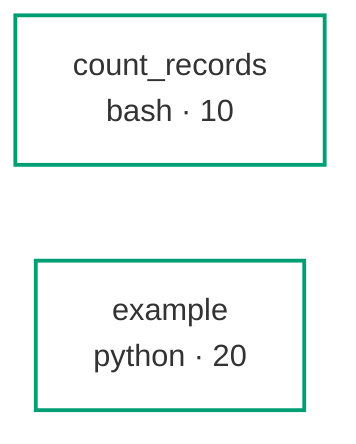

<!-- GENERATED BY labdocs — do not hand-edit. Regenerate with `labdocs render`. -->

# Codebase map — cancer_transcriptomics_teaching

_analysis flavour · 2 steps · 32 exempt helpers_

| # | Script | Path | Inputs | Outputs | Key options | Output meaning | Goes to |
|---|---|---|---|---|---|---|---|
| 10 | **count_records** | `scripts/bash/count_records.sh` | `settings/samples.tsv` (external) | `out_count_records_counts.tsv` | `--input_file` Delimited table to count · `--output_dir` Directory the counts table is written into (default outputs/10_count_records) · `--group_column` 1-based column index holding the group key (default 1) | One row per group with its record count, sorted by count descending. | **final** |
| 20 | **example** | `scripts/python/example.py` | `settings/samples.tsv` (external) | `out_example_kept.parquet` | `--max-length` Longest value of the length column to keep (default 150) · `--length-column` Column holding the length to threshold on (default length) · `--id-column` Column holding the record identifier (default id) | One row per surviving record, carrying its identifier and length. | **final** |

## Dataflow

## Helpers (exempt)

- `containers/build.sh` — Build tooling, not a pipeline step. Its artifact is a registry digest recorded in containers/digests.lock, not a file under outputs/, and it runs on a laptop rather than as part of any analysis.
- `scripts/python/build_kit.py` — instructor-side; packs the generated pages and tables into the student kit (Phase 2K)
- `scripts/python/build_preview.py` — instructor-side; builds the course preview, every module on made-up data until it is built
- `scripts/python/check_kit.py` — ships inside the student kit; checks a copy of the kit with the standard library alone
- `scripts/python/ena_samples.py` — course tool, not a pipeline step; tabulates each sample of an ENA study as ENA records it
- `scripts/bash/fetch_gdc.sbatch` — runs on Kebnekaise or a laptop into a ctx root's data/raw folder, never into outputs/
- `scripts/bash/fetchngs.sbatch` — runs on Kebnekaise into the student's run folder, never into outputs/
- `containers/figures_root.py` — build tooling; writes the fixture root the figures image's proof redraws from, outside outputs/
- `scripts/bash/job_name.sh` — sourced by every launcher; names Slurm jobs, runs no step
- `scripts/bash/kebnekaise_env.sh` — sourced by the cluster scripts beside it and by a login shell; runs no pipeline step
- `scripts/python/kit_datasets.py` — build_kit's helper, not a pipeline step; names the dataset file a rebuild command reads
- `scripts/python/kit_matrices.py` — build_kit's helper, not a pipeline step; keeps raw GDC count matrices out of a kit
- `bin/lib_slurm.sh` — Sourced helper library, not a pipeline step. It defines functions and writes nothing of its own, so it has no outputs to describe and no place in the DAG.
- `containers/lock.sh` — Build tooling, not a pipeline step. Sourced by containers/build.sh and by .github/workflows/containers.yml, the two writers of containers/digests.lock.
- `scripts/python/make_chr22_fixture.py` — instructor-side builder of tests/fixtures/chr22; needs the network
- `scripts/python/make_chr22_se_fixture.py` — instructor-side builder of tests/fixtures/chr22_se; standard library only, offline
- `scripts/python/make_fetchngs_fixture.py` — instructor-side builder of tests/fixtures/fetchngs; needs Docker and the network
- `scripts/python/make_quant_fixture.py` — instructor-side builder of tests/fixtures/quant; runs Salmon and R tximport, offline
- `scripts/python/make_rnaseq_fixture.py` — instructor-side builder of tests/fixtures/rnaseq; needs Docker and the network
- `scripts/python/preview_clinical.py` — instructor-side preview builder; the M10 page on made-up data until ctx clinical exists
- `scripts/python/preview_genecard.py` — preview builder; draws the M9 Gene cards page on made-up data until ctx genecard exists
- `scripts/python/preview_ncrna.py` — preview builder; draws the M8 Non-coding RNA page on made-up data until ctx ncrna is built
- `scripts/python/preview_process.py` — preview builder; draws the M3 page on made-up data where no reads or genome exist
- `scripts/python/preview_proteo.py` — preview builder; the M7 RNA versus protein page on made-up data, for the course preview
- `scripts/python/preview_quant.py` — preview builder; draws the M4 page through ctx.quant.page on made-up Salmon outputs
- `containers/prove_figures.py` — build tooling; the figures image's check, run by containers.yml, in a scratch folder
- `scripts/python/pyodide_harness.py` — Helper for spike_pyodide.py, not a pipeline step: it runs one Python function inside Pyodide under Node, or in a fresh CPython process, and reports timings, downloads and errors.
- `scripts/python/record_sanity.py` — P2C.3 one-off; writes the Step-1 record that tests/test_sanity_record.py reads
- `scripts/bash/rnaseq.sbatch` — runs on Kebnekaise into the student's run folder, never into outputs/
- `scripts/bash/site_kebnekaise.sh` — sourced by fetchngs.sbatch and rnaseq.sbatch; says what one computer changes, runs no step
- `scripts/bash/site_laptop.sh` — sourced by fetchngs.sbatch and rnaseq.sbatch; says what one computer changes, runs no step
- `scripts/python/spike_pyodide.py` — One-off Phase 1 feasibility spike (TODO.md P1.5), not a pipeline step. It decides whether the JupyterLite notebooks run pydeseq2 live; its record is a deliverable, read by no step.

---

Generated by labdocs (labcore 0.6.5) at 2026-10-23T09:38:51Z. GENERATED BY labdocs — do not hand-edit. Regenerate with `labdocs render`.
