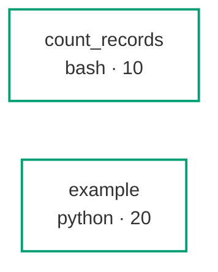

<!-- GENERATED BY labdocs — do not hand-edit. Regenerate with `labdocs render`. -->

# Codebase map — cancer_transcriptomics_teaching

_analysis flavour · 2 steps · 3 exempt helpers_

| # | Script | Path | Inputs | Outputs | Key options | Output meaning | Goes to |
|---|---|---|---|---|---|---|---|
| 10 | **count_records** | `scripts/bash/count_records.sh` | `settings/samples.tsv` (external) | `out_count_records_counts.tsv` | `--input_file` Delimited table to count · `--output_dir` Directory the counts table is written into (default outputs/10_count_records) · `--group_column` 1-based column index holding the group key (default 1) | One row per group with its record count, sorted by count descending. | **final** |
| 20 | **example** | `scripts/python/example.py` | `settings/samples.tsv` (external) | `out_example_kept.parquet` | `--max-length` Longest value of the length column to keep (default 150) · `--length-column` Column holding the length to threshold on (default length) · `--id-column` Column holding the record identifier (default id) | One row per surviving record, carrying its identifier and length. | **final** |

## Dataflow

## Helpers (exempt)

- `containers/build.sh` — Build tooling, not a pipeline step. Its artifact is a registry digest recorded in containers/digests.lock, not a file under outputs/, and it runs on a laptop rather than as part of any analysis.
- `bin/lib_slurm.sh` — Sourced helper library, not a pipeline step. It defines functions and writes nothing of its own, so it has no outputs to describe and no place in the DAG.
- `scripts/python/make_chr22_fixture.py` — instructor-side builder of tests/fixtures/chr22; needs the network

---

Generated by labdocs (labcore 0.6.5) at 2026-09-26T18:34:52Z. GENERATED BY labdocs — do not hand-edit. Regenerate with `labdocs render`.
